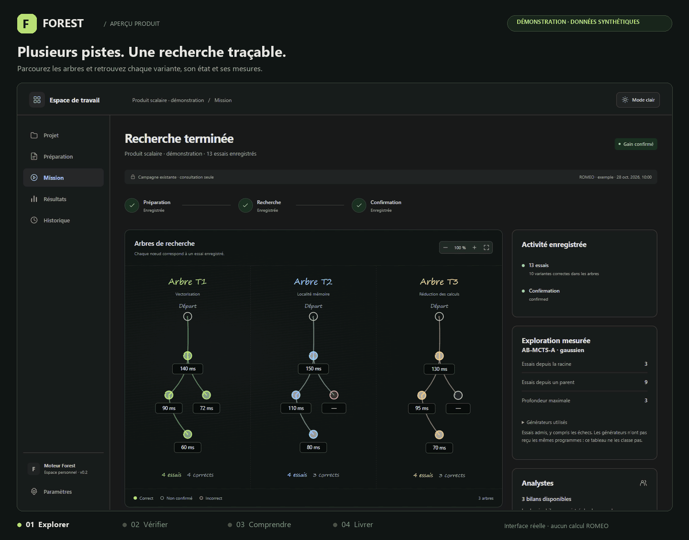

<div align="center">

# Forest

### L’optimisation de code, pilotée par la mesure.

Explorez plusieurs pistes. Inspectez chaque essai. Livrez un programme confirmé.

**C · C++ · CUDA** &nbsp; / &nbsp; **TreeQuest AB-MCTS** &nbsp; / &nbsp; **Version 0.2.0**

[Démarrer](#démarrer) · [Fonctionnement](#fonctionnement) · [Documentation](docs/README.md) · [Contribuer](CONTRIBUTING.md)

</div>

Forest accompagne l’optimisation de programmes de calcul : il propose des variantes,
les compile, vérifie leur correction et mesure leurs performances dans un contrat
figé. Son application locale permet de préparer une mission, de suivre son exécution
sur ROMEO et d’examiner le code, les décisions et les mesures qui conduisent au résultat.



<div align="center">

**Arbres → vérification → comparaison → livraison**

<sub>Interface réelle · données synthétiques · aucun calcul ROMEO.<br>
Les temps et gains affichés illustrent le parcours ; ils ne constituent pas un benchmark.</sub>

[Voir l’image fixe](docs/media/forest-overview.png) · [Scénario et reproduction du GIF](docs/DEMO.md)

</div>

## Ce que Forest apporte

| Besoin | Dans Forest |
|---|---|
| Explorer plusieurs pistes d’optimisation | Mother prépare les pistes ; les arbres utilisent la politique TreeQuest AB-MCTS-A et les analystes examinent les preuves. |
| Comprendre un résultat | Chaque essai expose ses sources, son diff, ses tests et ses mesures ; les liens de recherche, de délégation et d’intégration restent distincts. |
| Comparer sur une base stable | Cible, compilateur, entrées, périmètre modifiable et protocole sont figés pour la campagne. Les tests restent protégés. |
| Récupérer un résultat exploitable | Une confirmation indépendante précède la livraison du projet retenu, accompagnée d’un rapport et des mesures CSV. L’absence de gain reste explicite. |
| Retrouver son travail | Les projets et les preuves sont conservés localement ; le suivi d’un job déjà soumis reprend après fermeture de l’application. |

## Fonctionnement

1. **Importer.** Déposez un fichier, un dossier ou un ZIP, avec ses tests et ses
   documents. Forest conserve l’original et ses empreintes.
2. **Définir le contrat.** Précisez les commandes de compilation, de vérification
   et de mesure, les sources modifiables, la cible et le budget.
3. **Explorer.** Lancez explicitement la mission sur ROMEO. Suivez les arbres,
   inspectez les variantes et consultez les analyses enregistrées.
4. **Confirmer et récupérer.** Les combinaisons sont évaluées comme de nouveaux
   programmes. Après confirmation et finalisation, téléchargez le projet et ses preuves.

Le modèle par défaut est **GPT-6 Luna · effort max**, pour tous les rôles ; le
mélange de générateurs est désactivé. Chaque mission dispose d’une mémoire neuve.
Changer de cible, de compilateur ou de protocole exige une nouvelle campagne.

## Démarrer

**Prérequis :** Python 3.11 ou plus récent. Le profil Windows Python 3.13 dispose
de reçus de validation ; le profil Linux Python 3.12 est décrit dans le
[guide de distribution](docs/DISTRIBUTION.md).

Cloner uniquement la version actuelle du produit :

```text
git clone --depth 1 https://github.com/Gotman08/hpc-forest-r1.git
cd hpc-forest-r1
```

Puis, depuis la racine du dépôt, sous Windows avec Python 3.13 :

```powershell
python -m venv .venv
.venv/Scripts/python -m pip install -r requirements-windows-py313.lock
.venv/Scripts/python -m pip install --no-deps .
.venv/Scripts/python -m hpc_forest.webapp
```

Ouvrez **[Forest dans votre navigateur](http://127.0.0.1:8767)**.
Le stockage par défaut est `~/.hpc-forest/application`.
L’import et la préparation ne soumettent aucun job.

**Une nouvelle installation démarre avec un historique vide.** Le dépôt contient
le produit et ses exemples ; les projets personnels, campagnes, résultats et
journaux de calcul restent dans le stockage propre à chaque utilisateur.
Le GIF est une démonstration documentaire et n’ajoute aucune mission à l’application.
Voir [le démarrage sans historique](docs/CLEAN-INSTALL.md).

<details>
<summary>Installation depuis les sources sous Linux avec Python 3.12</summary>

```bash
python3.12 -m venv .venv
.venv/bin/python -m pip install -r requirements-linux-py312.lock
.venv/bin/python -m pip install --no-deps .
.venv/bin/python -m hpc_forest.webapp
```

Ce profil doit être vérifié sur la plateforme cible ; la présence d’une
configuration CI ne constitue pas un reçu d’exécution.

</details>

Pour lancer une recherche, configurez votre compte ROMEO à l’aide du
[guide de l’application](docs/APPLICATION.md#configuration-romeo) et du
[profil d’exemple](docs/romeo.example.json). Les identifiants restent dans votre
profil privé. Le contrôleur tourne dans l’allocation SLURM ; l’inférence utilise
OpenAI ou la passerelle dsh-romeo déjà active sur ROMEO. Après soumission,
la recherche peut continuer PC éteint.

## Périmètre et validation

| Sujet | État documenté |
|---|---|
| Application | Usage personnel local, serveur lié à `127.0.0.1`, exécution explicite sous le compte ROMEO de l’utilisateur. |
| Calcul CPU | Parcours validé sur ROMEO, CPU x86_64 et GCC 14.2.0. |
| Sources CUDA | Acceptées avec un programme hôte et des tests ; le parcours GPU ARM n’est pas validé par la livraison 0.2. |
| Correction et performance | Correction définie par les tests fournis ; performances liées aux entrées et au protocole mesurés. Aucun gain garanti. |
| Conservation | Reprise du suivi et sauvegarde vérifiée ; une panne du calcul distant ne déclenche pas de nouvelle allocation automatique. |

Les [contrôles de contribution](CONTRIBUTING.md#vérifier-un-changement) produisent
des reçus locaux de tests et de fabrication. Les anciennes campagnes et leurs
mesures sont conservées séparément du produit publié ; elles ne sont pas importées
au premier lancement et ne constituent pas une mesure de la version courante.

Forest exécute le code avec les droits du compte de calcul. Son déploiement
validé est personnel et local ; consultez la [sécurité](docs/SECURITY.md) pour
les frontières d’exécution et les conditions d’exposition.

## Documentation

Forest propose les modèles OpenAI et **DeepSeek V4.1 Flash via dsh-romeo**, avec
un effort adapté à chaque modèle. Pour connecter la passerelle ROMEO existante,
suivre le [guide dsh-romeo](docs/APPLICATION.md#dsh-romeo--deepseek-sur-romeo).

| Pour… | Lire… |
|---|---|
| Préparer et suivre une première mission | [Guide de l’application](docs/APPLICATION.md) |
| Installer une wheel ou fabriquer une livraison | [Distribution](docs/DISTRIBUTION.md) |
| Sauvegarder, restaurer ou migrer depuis 0.1 | [Migration et maintenance](docs/MIGRATION-0.2.md) |
| Comprendre le moteur et ses invariants | [Architecture](docs/ARCHITECTURE.md) |
| Vérifier une installation sans données personnelles | [Démarrage propre](docs/CLEAN-INSTALL.md) |
| Préparer une diffusion commerciale | [Dépendances et droits](docs/THIRD-PARTY-NOTICES.md) |
| Parcourir les guides du produit | [Index de documentation](docs/README.md) |

La version 0.2 retire le conseiller TabPFN du produit courant. Les anciennes
campagnes et leurs contrats restent consultables sans conversion à l’ouverture.
Voir le [journal des changements](CHANGELOG.md).

## Développer

```powershell
python -m pip install -e ".[web,dev]"
python -m pytest
python -m ruff check src tests
node --test "tests/*.mjs"
```

Les tests locaux n’appellent aucun modèle hébergé et n’allouent aucun job HPC.
Les tests avec compilation nécessitent GCC/G++. Le
[guide de contribution](CONTRIBUTING.md) décrit les contrôles et l’organisation
du dépôt ; `python tools/check.py` produit un reçu consolidé.

---

Les droits de distribution de Forest restent à définir par leurs titulaires.
Les codes importés, dépendances et services conservent leurs conditions propres.
Les [notices](docs/THIRD-PARTY-NOTICES.md) recensent les points à vérifier avant diffusion.
