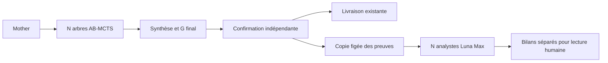
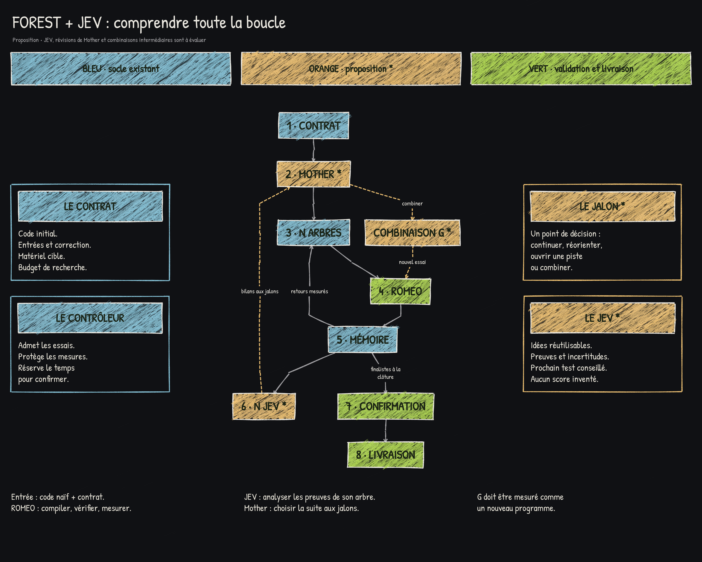

# Premier lot — Luna Max et analystes en observation

L'objectif est d'évaluer ce que les analystes reconnaissent dans les preuves
d'un arbre **sans modifier la recherche qui les produit**. Ce lot ne démontre
pas un gain de speedup : il prépare une expérience permettant de l'évaluer.

## Modèle fixe

La série actuelle impose `gpt-6-luna` et `reasoning_effort = "max"` pour tous les
rôles Codex : Mother, arbres, réparations, sélection de fusion, génération de G
et analystes. La configuration par défaut, le backend direct, la boîte aux
lettres et le processus Codex natif portent cette identité explicitement.
L'adaptateur des anciennes matrices refuse désormais les autres identités.
Les backends historiques `recipe` et `ollama` restent des modes distincts ;
ils ne font pas partie de cette série Codex ni du mode analystes.

Un profil historique incompatible doit rester archivé et être relancé dans une
nouvelle campagne. Aucun registre historique n'est réécrit pour lui attribuer
Luna Max. Une requête et son reçu enregistrent le modèle demandé ; cela ne
constitue pas une preuve indépendante des poids exécutés par le fournisseur.

## Position dans la boucle



Les appels d'analyse ont lieu **après la confirmation**. Un observateur appelé
pendant la recherche consommerait du temps, des ressources ou des capacités du
service, et pourrait modifier les admissions malgré l'absence de rétroaction.
Ce choix diffère donc volontairement de l'emplacement futur aux jalons du
schéma. Aucun appel analyste n'est inséré dans le contrôleur ou l'ordonnanceur.
Le lancement de l'observation est une commande explicite séparée.

Les anciens profils utilisant déjà Luna Max conservent leurs prompts et leur
politique de recherche. Fixer Luna Max pour un profil qui utilisait un autre
modèle change nécessairement ses générations : ce changement est distinct de
l'ajout des observateurs. L'absence d'influence garantie ici concerne ce dernier.

## Utilisation

Préparer les dossiers d'une campagne Mother terminée, sans appel au modèle :

```sh
hpc-forest-r1 observe /chemin/campagne /chemin/observations --max-calls 8
```

La campagne doit avoir terminé la recherche, la fusion finale et la confirmation
indépendante ; aucun essai ne doit être en attente. Le dossier de destination
doit être neuf et extérieur à la campagne. Le registre est ouvert en SQLite
`mode=ro`, avec `query_only` et une transaction de lecture ; la classe `Registry`
et ses migrations ne sont pas utilisées.

Lancer les analystes sur la machine disposant du CLI Codex authentifié :

```sh
hpc-forest-r1 observe-run /chemin/observations
```

Ou préparer puis lancer dans une seule commande :

```sh
hpc-forest-r1 observe /chemin/campagne /chemin/observations --max-calls 8 --run
```

Pour ROMEO, préparer sur ROMEO une fois le calcul terminé, puis transférer le
dossier d'observation complet sur le poste qui exécute Codex. `observe-run`
utilise uniquement les copies figées : il n'a pas besoin de monter le système
de fichiers de ROMEO, d'ouvrir le registre d'origine ou de soumettre un job.
L'inférence est hébergée ; l'emplacement du CLI ne transforme pas l'analyse
en mesure matérielle sur ROMEO.

## Preuves et mémoire

Chaque analyste reçoit son propre objectif, le contrat matériel/protocole, la
référence initiale et uniquement les essais de son arbre. Les arbres de fusion
internes `G-merge-*` ne sont pas des arbres de recherche et n'ont pas d'analyste
dans ce lot. Les résultats de G et des autres arbres ne sont pas injectés dans
le contexte d'un analyste.

Le dossier comprend :

- les résultats enregistrés et les confirmations disponibles, avec leurs phases ;
- les liens distincts de parent de recherche, parent de délégation et sources ;
- les sources exactes des commits et leurs empreintes ;
- les tentatives de développement et de réparation lorsque leurs journaux existent ;
- les diagnostics disponibles, avec empreinte et aperçu explicitement tronqué
  au-delà de 16 000 octets par journal ; les sources absentes sont signalées.

L'analyste parcourt un catalogue paginé (six preuves par page), demande le détail
d'une preuve ou un extrait de source (12 000 caractères par lecture). Les sorties
indiquent les offsets suivants : aucune lecture partielle n'est présentée comme
une lecture intégrale. L'accès au code est une recherche dans les données figées,
jamais une lecture d'un chemin choisi par le modèle sur la machine.

Chaque arbre commence avec un contexte neuf. Les appels suivants reçoivent
explicitement l'historique borné de ses lectures. Les sessions natives sont
éphémères ; mémoire native, outils, shell, web, MCP, plugins et sous-agents sont
désactivés. Les nouvelles observations ne sont jamais ajoutées aux tables
`memory_facts`, `trials`, `evaluations` ou aux conversations Mother.

## Contrat et budget de l'analyste

Les réponses structurées distinguent des observations citées, des hypothèses
avec prochain test et condition d'arrêt, et des incertitudes. Toute référence
hors des preuves visibles de l'arbre est rejetée. Aucun champ n'autorise à
attribuer un score, modifier un programme ou exécuter une recommandation.
Une citation valide n'établit pas la vérité de son interprétation : le bilan
reste un avis du modèle à confronter aux preuves.

La limite par défaut est huit appels par arbre, configurable de 1 à 16. Chaque
lecture consomme un appel et le dernier doit rendre un bilan. Cette limite et
les tokens observés sont séparés du budget de recherche. Il n'y a pas de plafond
applicatif de tokens ; un appel engagé finit. Les analystes sont exécutés
séquentiellement pour limiter leur concurrence sur le service.

La revendication d'un appel est sauvegardée avant son lancement. Un arrêt ou une
erreur ne déclenche jamais un deuxième appel automatiquement. Une nouvelle
exécution d'`observe-run` conserve les analystes terminés ou échoués et traite
uniquement ceux qui n'ont pas commencé. Un analyste interrompu est marqué
`interrupted_unknown`, sans invention d'un coût nul. Pour une nouvelle tentative
volontaire, préparer un **nouveau** dossier ; elle constitue une nouvelle analyse
payante et ne remplace pas l'ancienne.

## Livrables et vérification

`manifest.json` identifie les preuves et les limites. Chaque `tree-*/snapshot.json`
contient son dossier, `state.json` son état et sa couverture, et `call-*/` les
requêtes et reçus natifs. `report.json` et `REPORT.md` regroupent les bilans et
la consommation connue/inconnue. Un bilan peut couvrir seulement une partie
des preuves ; la couverture du catalogue et les lectures sont exposées.
Les erreurs d'un analyste ne bloquent pas les autres et ne changent pas le
résultat officiel. Le CLI retourne un code non nul si un bilan manque.

Les tests vérifient notamment une campagne avec générations simulées, **vrais
programmes C compilés, véritable AB-MCTS et confirmation**, puis l'égalité des
tables du registre avant et après observation. Ils couvrent aussi l'identité
du modèle sur les différents transports, les sources paginées, l'isolation des
arbres, les accès refusés, les enveloppes de réponse, l'interruption et la reprise.

## Schéma de référence



Image fournie par l'utilisateur et conservée sans modification. Les éléments
orange représentent des propositions. Ici, « JEV » est le rôle d'analyste exécuté
par Luna Max ; aucune intégration TypeSafe AI n'est ajoutée. Les bilans aux jalons,
la réorientation de Mother, les candidats conservés sur avis et les nouvelles
combinaisons intermédiaires appartiennent aux lots suivants et nécessiteront
des comparaisons contrôlées sur ROMEO à budget et entrées identiques.

Les tests automatisés, le contrôle natif de deux analystes et leurs limites sont
décrits dans [la validation du lot](VALIDATION-ANALYSTES.md).
