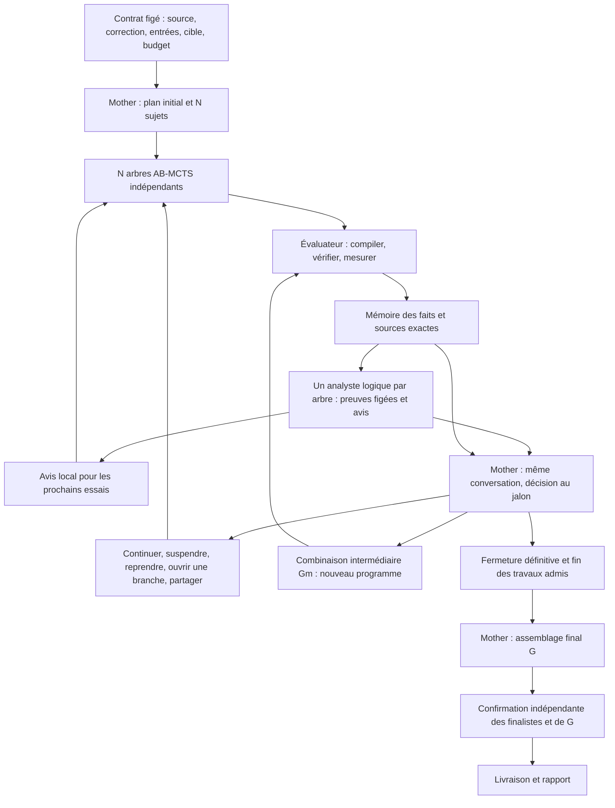

# Forest actif : analystes par arbre et pilotage aux jalons

La boucle active est une option de **nouvelle campagne**. Elle conserve GPT-6
Luna avec l'effort `max` pour chaque rôle Codex. Les campagnes historiques et le
mode d'observation après confirmation gardent leur fonctionnement.



## Activation et ablations

À partir d'une configuration Codex mailbox autorisée et d'un canal neuf :

```sh
python -m hpc_forest init campagne --config config-codex.json --mother-trees --active-mode full --duration 2h
python -m hpc_forest run campagne --confirm
python -m hpc_forest report campagne
```

`--active-mode` active aussi la mémoire et le harnais de développement. La CLI
conserve la confirmation dans `run --confirm` ; l'API Python appelle successivement
`Controller.run()` et `Controller.confirm()`. Un checkpoint de recherche n'est
pas une livraison confirmée.

| Mode | Ce qui peut influencer les prochains essais |
|---|---|
| `off` (défaut) | Ordonnanceur historique, aucun appel de contrôle actif |
| `local` | Avis de l'analyste de chaque arbre |
| `steering` | Avis locaux et Mother : continuer, suspendre, reprendre, créer une branche, fermer |
| `sharing` | En plus, import explicite de preuves entre arbres |
| `full` | En plus, combinaisons intermédiaires mesurées |

La configuration `forest.active` accepte `analysis_every` (défaut 3 essais
terminés), `analysis_calls` (3), `steering_calls` (3), `control_workers` (1) et
`surprise_gain` (0,25). Le seuil de surprise porte sur la baisse du temps mesuré
par rapport au meilleur temps antérieur disponible ; ce n'est pas un test de
significativité. Une nouvelle catégorie d'échec peut aussi déclencher une analyse
après un premier bilan. Un état inchangé n'est pas réanalysé.
Quand plusieurs arbres attendent, les arbres jamais analysés puis ceux dont le
dernier bilan est le plus ancien passent en premier.

## Rôles et droits

L'analyste reçoit un instantané de son arbre, du naïf et des seules preuves
importées explicitement. Les faits, les sources complètes et les diagnostics sont
consultables par pages. Le dernier appel autorisé doit produire un bilan, avec
preuves citées, hypothèses, prochain test et condition d'arrêt. Les appels sont
éphémères ; le contrôleur reconstruit le contexte explicite. Le dernier bilan
est fourni comme interprétation et les bilans antérieurs restent archivés.

Mother conserve sa conversation native depuis la planification jusqu'à
l'assemblage final. Une phase `steering` permet plusieurs décisions pendant la
recherche. Après `assembly`, aucun retour au pilotage ou à la planification n'est
accepté. Les analystes et les décisions de pilotage n'ont aucun outil d'exécution :
ils lisent les preuves figées par le contrôleur.

Les sujets existants sont immuables. Changer d'objectif ou de base crée une
nouvelle identité `Tn`, avec un état TreeQuest neuf. Les liens entre parent AB-MCTS,
base mesurée, décision et sources d'intégration restent distincts. Une combinaison
`GmN` reçoit deux à quatre programmes corrects et mesurés, démarre depuis le plus
rapide de ces programmes et produit un seul nouvel essai. Ses sources ne reçoivent
aucune copie de sa récompense. Si Gm échoue ou régresse, les sources restent
disponibles ; seul un résultat correct et mesuré peut amorcer une nouvelle branche.

Les conditions d'arrêt rédigées par le modèle sont des critères pour les avis et
le pilotage de Mother. Le contrôleur ne transforme pas une phrase libre en
prédicat exécutable. Il applique les décisions structurées et les bornes de budget.

## Concurrence, temps et reprise

Les N arbres initiaux démarrent ensemble. Les arbres créés ensuite partagent les
N places de génération de recherche ; un arbre a au plus un essai en cours.
Les places supplémentaires de contrôle sont déclarées dans `forest-plan.json` :
avec N arbres et `control_workers=1`, la capacité totale du worker est N+1.
Les mesures restent sérialisées sur la cible. Les threads de contrôle attendent
les réponses du modèle ; seul le contrôleur écrit son état et celui de TreeQuest.

Chaque appel d'analyse ou de pilotage doit être admis dans la même durée que la
recherche. Les lectures supplémentaires sont réadmises séparément. L'estimation
inclut les appels en cours et préserve l'assemblage final et la confirmation.
Un travail déjà admis se termine, même après suspension d'un arbre ou fermeture
des nouvelles admissions. La durée peut donc dépasser la cible annoncée.

La revendication d'un appel est durable avant sa publication. Sa réponse est
conservée avant application. Une réponse durable peut être reprise et appliquée
une seule fois ; un appel incertain n'est jamais rejoué. Un avis indisponible
n'attribue pas de score au programme. Une consommation inconnue reste inconnue.
Les compteurs natifs cumulés de Mother sont soustraits du compteur vérifié du
tour précédent avant imputation au budget ; les événements bruts sont conservés.
Un compteur manquant ou réinitialisé ne devient pas une consommation nulle.
La perte du reçu natif de Mother arrête le pilotage : le moteur ne crée pas une
nouvelle Mother en prétendant poursuivre la conversation précédente.

Les décisions portent l'identité de l'instantané et la révision du plan. Une
révision périmée est rejetée. Des résultats arrivés depuis l'instantané sont
conservés et signalés dans le reçu ; ils ne réécrivent pas les preuves consultées.
Les droits d'import sont figés pour chaque mission au moment de son admission.
Le schéma transmis au modèle distingue chaque type d'action et borne les
références aux identifiants visibles. Les conseils utilisent `rationale` et
`stop_condition` ; `subject` et `objective` sont réservés aux nouveaux arbres.
Les champs inapplicables sont absents du format demandé. Pour une création,
`tree` est omis afin que le contrôleur attribue une nouvelle identité.
Ces contraintes de génération complètent la validation du contrôleur.
Une réponse connue mais mal formée reçoit le motif du rejet. Un nouvel appel
peut la corriger dans la même limite d'appels et avec une nouvelle admission au
budget. Une réponse incertaine n'est jamais rejouée. Après le dernier appel, le
contrôleur conserve l'échec ; Mother reçoit son motif au prochain jalon.

## Preuves disponibles

Le rapport conserve `active-architecture.json`, `active-control.csv` et
`active-decisions.csv`. Chaque appel comporte son instantané, son coût connu ou
inconnu, sa durée, sa couverture et son état. Chaque décision peut être reliée
aux essais qui en ont utilisé l'avis, la base ou les sources. `experiments.csv`
ajoute la catégorie du programme et ces identifiants de provenance.

Les durées d'appels se chevauchent avec la recherche : leur somme n'est pas la
durée murale de la campagne. La compilation, le temps de recherche et la vitesse
du programme livré sont des mesures distinctes.

Les tests ciblés vérifient la portée des preuves, les reprises, les budgets,
les reçus de conversation, les branches, les imports et la confirmation. Les
scénarios de pipeline remplacent seulement l'inférence par des réponses de test ;
ils compilent réellement les candidats C et exécutent TreeQuest. Les campagnes
ROMEO utilisent des appels Luna réels et des protocoles protégés.

Une mémoire neuve signifie un nouveau registre, une nouvelle session et aucune
solution antérieure fournie à la recherche. Cela ne signifie pas une purge des
caches physiques d'un nœud partagé. Les comparaisons doivent remesurer les sources
anciennes et nouvelles dans une même allocation, avec les mêmes entrées et
compilateurs. Un seul tirage de recherche par programme ne démontre pas une
supériorité statistique de l'architecture.
