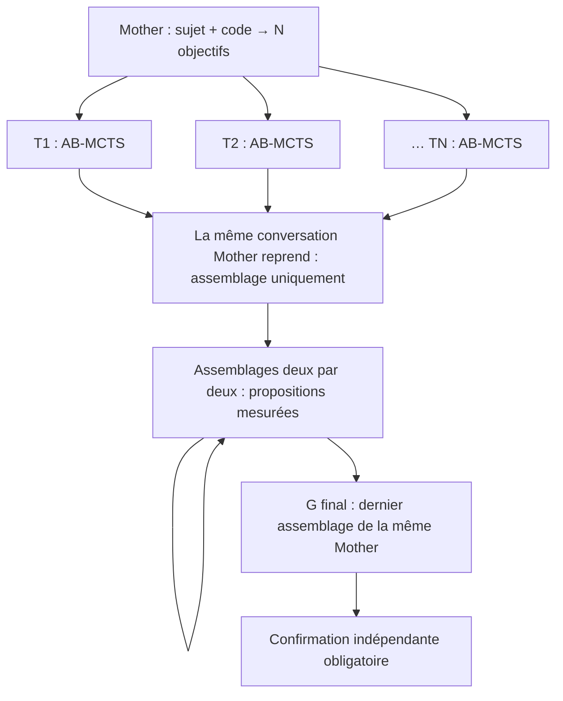

# Mother choisit N arbres AB-MCTS

Le [harnais mémoire optionnel](MEMOIRE.md) ajoute la politique
`memory-guided-v1` : recherche paginée dans les N arbres, choix explicite des
sources, écriture du code combiné et mesure de chaque combinaison. Les
descriptions de réduction par paires ci-dessous concernent la politique
historique `pairwise`, qui reste disponible. Aucun de ces modes ne fixe N.

Le mode `--mother-trees` (`forest.policy = "mother"` et
`forest.conversation = "persistent"`) remplace la liste fixe A/B/C par un plan
produit par Mother à partir du sujet, des sources et de la mesure de référence.
Mother choisit **N**, donne un sujet distinct et un objectif précis à chaque
arbre, puis le contrôleur attribue les identifiants stables `T1` à `TN`.
Le schéma ne fixe aucun nombre maximal d'arbres.
La durée cible et le temps restant ne sont pas transmis à cette planification.
Mother choisit N selon le sujet, les sources et les pistes utiles. Le contrôleur
garde la gestion du temps et des réserves.

**Les N arbres travaillent tous en parallèle.** Il n'existe aucun réglage de
parallélisme dans ce mode : la concurrence de génération est égale à N.
Le champ historique `budget.max_workers` ne découpe pas cette forêt en groupes.
Le relais natif utilise également N capacités d'exécution ; il ne conserve pas
le plafond implicite du pool Python par défaut.



## Exécution

Chaque arbre conserve son véritable état TreeQuest AB-MCTS-A 0.3.2 : ses
parents de recherche, ses propositions, ses continuations, ses scores et son
générateur aléatoire. Son objectif reste celui attribué par Mother.
Les sujets ne sont pas des recettes A/B/C renommées.

Le premier départ admet les N arbres dans une seule réservation atomique et
lance leurs générations ensemble. Ensuite, chaque arbre poursuit sa propre
boucle : choix du parent par AB-MCTS-A, génération, évaluation exclusive, puis
mise à jour du score et nouvelle admission. Il ne reste pas de barrière entre
les générations des différents arbres. Un arbre rapide peut donc commencer
son deuxième candidat pendant qu'un autre termine encore son premier.
Un même arbre garde au plus une mission en attente : son prochain choix utilise
toujours le résultat déjà enregistré de la mission précédente. Les réparations
autorisées restent attachées à leur mission. Les mises à jour TreeQuest et SQLite
appartiennent au seul contrôleur ; seules les générations utilisent les N workers.
Les mesures attendent leur tour sous le verrou de cible, y compris lorsqu'un
autre enfant effectue une vérification de développement sur le même GPU.
Cette attente ne devient pas un échec d'infrastructure.

`T1, T2, …, TN` représente exactement N arbres au total. Les passes AB-MCTS
développent leurs états existants tant que le budget laisse la réserve
adaptative. Pendant cette phase, Mother reste en attente ; il n'y a pas
d'intégration G intermédiaire suivie d'un retour à la recherche.

Quand les admissions ferment, les travaux engagés finissent. **La conversation
native initiale de Mother reprend**, avec le même UUID Codex et son historique
de planification. Le contrôleur sélectionne le meilleur programme correct mesuré
de chaque arbre et les réduit par paires, en conservant les autres programmes
dans l'archive. Chaque étape reçoit au plus deux programmes complets, leurs
identités, leurs commits et leurs mesures. Les sources proviennent exactement
des commits mesurés ; elles ne sont pas remplacées par des diffs tronqués.
**Mother assemble elle-même le code** :
G est son programme intégré, pas un autre modèle chargé de traduire ses consignes.
Ce programme est compilé, vérifié et mesuré comme un nouveau candidat ; son
score n'est pas recopié dans les arbres sources.

Avec huit programmes valides, la réduction passe de 8 à 4, puis à 2, puis à 1 :
sept propositions d'assemblage dans la même conversation. Ces étapes se suivent ;
elles ne démarrent pas de nouveaux modèles. Avec un nombre impair, le dernier
programme passe au niveau suivant sans appel. Avec un seul programme valide, Mother
produit quand même un G final. En l'absence de candidat valide, la référence validée
sert d'entrée à ce dernier assemblage.

Chaque proposition intermédiaire est compilée, vérifiée et mesurée. Le programme
transmis au niveau suivant est le meilleur programme mesuré parmi les deux entrées
et la proposition valide. Une proposition incorrecte ou plus lente ne remplace
donc pas une meilleure entrée. Le dernier G est évalué puis confirmé indépendamment,
même s'il ne bat pas les candidats précédents. Le meilleur programme confirmé
reste celui retenu pour l'archive de soumission.

Le mode `forest.integration = "pairwise"` laisse **Codex CLI gérer automatiquement
la compaction de son historique**. Le contrôleur ne fabrique pas de résumé de
conversation, ne remplace pas son historique et ne crée pas une nouvelle Mother.
Le registre conserve séparément chaque paire, son résultat, la sélection et le
reçu de conversation ; ces preuves sont exportées dans `postprocess.steps`.

Le passage à l'assemblage est définitif pour l'epoch. Mother n'a aucun outil de
lancement de modèles et le contrôleur refuse toute admission ou génération de recherche
après cette transition. Le schéma de réponse d'assemblage accepte du code,
pas une nouvelle liste de fils. **Aucune flèche ne repart vers les arbres**.
Si une réparation de compilation est autorisée, elle poursuit la même
conversation avec les diagnostics, sans créer de modèle ou d'arbre supplémentaire.

La première passe fait partie du travail engagé avec la planification Mother :
une fois N choisi, les N arbres démarrent même si cette planification a débordé
de la cible. Les missions suivantes sont admises individuellement lorsque leur
coût prévu, les travaux déjà engagés et la réserve de finalisation tiennent
dans le temps restant. Un arbre dont le prochain essai est trop long ne bloque
pas une mission plus courte d'un autre arbre. Quand aucune admission ne tient,
les travaux engagés finissent avant la reprise de Mother.
La réserve estime désormais toutes les fusions successives : au plus N−1 pour
N programmes, ou une proposition finale pour zéro ou un candidat. Une grande
forêt peut donc augmenter la durée de finalisation ; les étapes engagées ne
sont pas annulées pour respecter exactement la cible.

La durée reste configurable (`30m`, `2h`, `5h`, `24h`, etc.), sans plafond de
tokens, de profondeur, de cycles ou de sommets. Les modèles admis finissent.
La reprise de **la même Mother pour produire G final**, puis sa **confirmation
indépendante obligatoire** terminent la campagne, même après la cible. Le programme retenu
est le meilleur programme confirmé ; G final n'est pas présumé meilleur.

## Préparer une nouvelle campagne Luna Max

```powershell
python tools/prepare_smoke.py --duration 30m --mother-trees
```

Cette commande prépare un dossier neuf et son payload local. Elle n'appelle
aucun modèle et ne soumet aucun job. Le nouveau contrat natif est
`r1-official-luna-max-mother-pairwise-v7`. Il fixe Luna Max et AB-MCTS, mais
laisse le nombre d'arbres à Mother. Le nombre de reprises et de missions
d'assemblage est déterminé après la recherche, sans plafond artificiel de deux
missions de post-traitement. Les contrats v5 et v6 conservent leurs profils
historiques et leurs anciennes règles de synthèse.

Pour un contrôleur local déjà configuré avec le transport `codex-mailbox`,
`init --mother-trees --duration 2h` active la même politique.
`--statement chemin.txt` fournit le texte du sujet à Mother comme donnée.
Le relais générique se lance aussi avec `codex_worker --mother-trees` ; le
relais du contrat natif v6 suit automatiquement le plan du contrôleur.

## Accès des modèles à MCP-ROMEO

Les nouvelles préparations `--mother-trees` inscrivent désormais
`model_mcp = {server: "romeo", profile: "existing-user", policy: "romeo-tools-v1"}`
dans le plan gelé. Le relais transmet ce serveur à **Mother, à chaque enfant et
à Mother lorsqu'elle reprend sa conversation pour assembler G**. Chaque processus
natif possède sa propre connexion stdio ; les connexions des N enfants peuvent
fonctionner en parallèle.

`--codex-config` doit désigner la configuration qui contient le serveur ROMEO
à utiliser, normalement `$env:USERPROFILE/.codex/config.toml` sous Windows
(ou `$env:CODEX_HOME/config.toml` si ce dossier est personnalisé). Le relais
réutilise exactement `mcp_servers.romeo.command`, ses arguments, son environnement
et son dossier de travail. Il conserve le profil ROMEO, le compte et l'identité
SSH existants. Aucun autre serveur MCP du fichier n'est transmis aux modèles.
Un ancien fichier de configuration du relais peut pointer vers une autre
installation de ROMEO : choisir le fichier utilisateur pour retrouver celle
utilisée par l'application.

Sous Windows, utiliser un Python classique pour le relais. Une distribution
Microsoft Store peut rediriger `AppData/Roaming` et empêcher le démarrage d'un
serveur dont le Python de base a été installé par uv, même si ce fichier existe.
La vérification réelle utilise CPython 3.13 avec le serveur de l'application ;
elle n'exige aucun changement du compte ou de la configuration SSH.

Les modèles peuvent consulter la documentation, les logiciels, les ressources et
les diagnostics, puis conduire des expériences distantes dans le périmètre autorisé
de leur mission. Les mesures officielles et la confirmation indépendante restent
effectuées par le contrôleur. Les outils ROMEO dédiés au lancement ou à la discussion
avec d'autres LLM sont désactivés. Le shell local et la délégation native restent
désactivés. L'accès MCP ne rouvre jamais la recherche pendant l'assemblage.

Les identifiants et les valeurs d'environnement restent sur le PC. La ligne de
commande native contient un lanceur local et l'empreinte de la configuration,
sans recopier les secrets. `invocation.json` conserve cette liaison et l'empreinte
des instructions effectives ; le prompt original reçu dans la boîte aux lettres
reste intact. Les appels MCP, leur outil et leur statut sont conservés dans les
événements natifs et dans l'usage, sans double compter début et fin d'un appel.
Un serveur indisponible ou une configuration modifiée provoque une erreur explicite.

Les plans et campagnes historiques sans ce champ restent sans outils modèle.
Le relais générique `codex_worker --mother-trees` active également cet accès à
partir de son `--codex-config`. Ni l'accès MCP ni le lanceur n'ajoutent de plafond
de tokens ou de durée aux générations admises.

Les nouveaux plans ajoutent aussi `hpc_docs`, un accès aux références officielles
NVIDIA, OpenMP, MPI, SIMD et compilateurs. Mother et tous les enfants partagent
ses instantanés pendant la recherche et la fusion ; la documentation ROMEO
reste dans `romeo`. Voir [les sources, les outils et les preuves documentaires](DOCUMENTATION-OFFICIELLE.md).

## Reprise et preuves

Le registre conserve le plan Mother, les N sujets, leurs objectifs, l'epoch,
le commit source et les empreintes des requêtes/réponses. Il conserve aussi
l'identifiant de conversation, l'UUID natif et la chaîne des tours. Le relais
utilise une session persistante, puis `codex exec resume <UUID>` ; jamais
`--last`, un fork ou un nouveau démarrage pour remplacer un historique perdu.
Une reprise normale
réutilise le même plan et les mêmes arbres. Un nouvel epoch planifie à partir
du nouveau code. Un appel déjà revendiqué ou une passe interrompue ne sont
pas rejoués pour masquer une consommation incertaine. Si l'historique natif
manque ou ne correspond plus au reçu précédent, l'assemblage échoue
explicitement, sans recréer Mother ni relancer les arbres.

`status`, `report/experiments.json`, le rapport Markdown et le manifeste de
`submission.zip` exposent la forêt choisie. Chaque essai de recherche conserve
son objectif et ses liens de provenance. Le lanceur refuse d'annoncer une
campagne complète si un arbre choisi n'a jamais été traité ou si G final n'a
pas son reçu de confirmation.

Le registre et les rapports exposent aussi `research_scheduler`, les événements
`research_node_submitted` / `research_node_settled` et les durées de génération
et d'évaluation séparées. `completed_batches` compte les tours complets communs
aux N arbres ; les nombres de sommets par arbre peuvent différer. L'option
explicite de checkpoint `max_batches` conserve une frontière par arbre, sans
devenir un quota pendant une exécution normale.
Les lanceurs courants appellent `run()` sans cette frontière et publient leurs
instantanés après chaque sommet via `on_progress`, plutôt que de recréer des
vagues pour alimenter leur fichier de progression.

Les tests locaux utilisent des sorties de modèles simulées avec le vrai
TreeQuest et de vraies compilations/validations C. Des barrières de concurrence
vérifient N=1, 5 et 8 côté contrôleur, puis 8 et 40 appels côté relais, afin de
détecter une exécution séquentielle ou un plafond caché. Ils couvrent aussi la
fin après le timer, la reprise, les plans invalides et la confirmation de G.
Ils ne constituent pas un nouveau benchmark Luna sur ROMEO.
