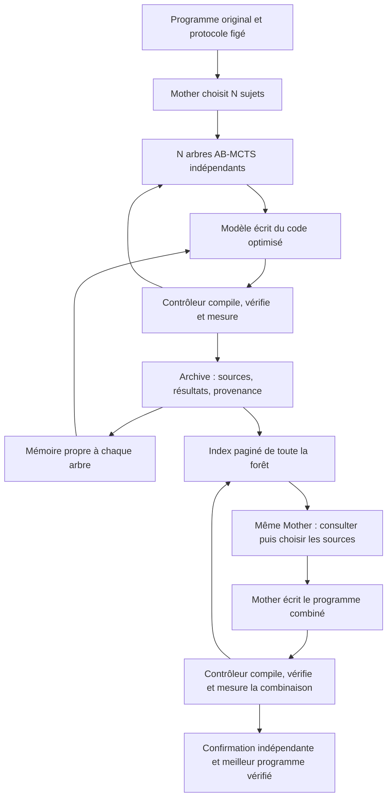

# Mémoire des arbres et intégration guidée

Le mode `memory-guided-v1` conserve les **N arbres choisis par Mother**, leur
politique réelle TreeQuest AB-MCTS-A, leurs worktrees et leurs mesures. N n'est
pas une constante : 2, 7, 20, 500 ou 600 arbres utilisent le même mécanisme.
La taille d'une page de mémoire ne limite pas le nombre d'arbres.

Chaque sommet écrit réellement du code : le modèle renvoie les fichiers source
complets modifiés, le transport les valide et le contrôleur compile, vérifie puis
mesure le programme. Le harnais peut réparer un échec de compilation ou de
correction. Il s'arrête au premier précontrôle réussi ; l'optimisation suivante
reste un nouveau sommet AB-MCTS, pas une recherche cachée dans le harnais.



## Activation dans une nouvelle campagne

Les configurations sans `memory` gardent le comportement antérieur. Une
configuration déjà figée n'est jamais modifiée pour activer la mémoire.

```json
{
  "forest": {
    "policy": "mother",
    "conversation": "persistent",
    "integration": "memory-guided-v1"
  },
  "memory": {
    "mode": "active",
    "context_characters": 12000,
    "page_size": 6,
    "reads_per_mission": 3,
    "assembly_rounds": 3,
    "selection_calls": 4,
    "sources_per_integration": 3
  },
  "harness": {"enabled": true, "max_attempts": 3, "call_token_ceiling": null}
}
```

L'extrait illustre les réglages mémoire ; le fichier JSON préparé par
`examples/cuda_nbody/prepare_memory.py` fournit une configuration complète et
valide. Les profils Mother conservent
`finish-started`, les réserves adaptatives, les tokens observés sans quota
applicatif et la confirmation obligatoire de G final.

### Budget de temps

La réserve estime le travail probable, séparément des plafonds de sécurité.
Elle prévoit deux tours d'intégration par défaut
(`completion.initial_integration_rounds`), dans la limite de `assembly_rounds`.
Ce dernier est un plafond d'expériences possibles, pas du travail certain : le
pilote CUDA en autorise jusqu'à 16, sous réserve du temps disponible et des
décisions de Mother. Cette capacité permet d'utiliser une finalisation plus
rapide que prévu pour de nouveaux programmes réellement évalués.
Avant les premières mesures, un tour d'intégration compte un épisode de code
(`completion.initial_model_seconds`, 120 s par défaut) et deux appels de
sélection (`completion.initial_selection_calls`, 2 par défaut), estimés à
30 s chacun (`completion.initial_selection_seconds`). Les durées et nombres
d'appels observés remplacent ensuite ces valeurs initiales. Un épisode de code
mesuré inclut déjà ses lectures et réparations : elles ne sont pas ajoutées une
seconde fois. La marge configurable couvre l'incertitude.

Augmenter N ou autoriser davantage de lectures ne réserve donc pas d'emblée le
coût maximal de toutes les pages et réparations. Pendant l'assemblage, chaque
lecture optionnelle doit laisser le temps estimé d'une décision, du code et de
la confirmation. Mother doit ensuite choisir avec les preuves déjà consultées.
Un tour supplémentaire réserve une décision obligatoire, le code et la
confirmation. Il peut donc être admis sans lectures supplémentaires lorsque le
temps manque ; chaque lecture éventuelle reste soumise à son propre contrôle.
Le premier programme combiné, les travaux déjà admis et la confirmation restent
obligatoires et vont à leur terme. La durée cible est une prévision, pas un
minuteur qui interrompt un modèle ou un contrôle en cours.

Les modes sont `off`, `record-only` et `active`. `record-only` enregistre les
preuves sans modifier les prompts. `active` exige le harnais, les arbres Mother
et le retour des mesures ; il ne s'applique pas à `H-no-feedback` ni au mode
binaire. L'intégration historique `pairwise` reste disponible.

## Données et apprentissage

Les tables supplémentaires du registre sont des projections dérivées :

- `memory_facts` contient les essais de **tous** les statuts, les instantanés de
  développement et les leçons des modèles. Une variante lente reste présente.
- `memory_terms` indexe les mots des fiches pour les recherches ciblées.
- `memory_ingested` marque les essais projetés et rend la reprise idempotente.

Le contrôleur enregistre les faits après la transaction `Search.finish` : commit,
parent de recherche, parent de délégation, sources d'intégration, correction,
temps, score et diagnostics. Les précontrôles sont identifiés comme tels et ne
deviennent pas des récompenses. Un échec d'infrastructure conserve un score
absent ; un programme incorrect conserve son score nul.

Les hypothèses, transformations déclarées, conditions d'application et prochaines
expériences restent dans `model_interpretation`. Les leçons sont ajoutées comme
de nouvelles versions avec leurs références ; elles ne remplacent pas les faits.
Les citations inconnues ou non consultées sont rejetées. Le code ne réécrit ni
les tests, ni les skills de confiance, ni les règles du contrôleur pour « apprendre ».
La mesure finale d'un candidat est ajoutée par le contrôleur, puis disponible au
sommet suivant : aucun appel de modèle supplémentaire systématique n'est nécessaire.

L'ingestion et la récupération utilisent les essais durables, les événements
d'usage et `logs/<mission>/node-harness.json`. `rebuild_memory(root)` reconstruit
uniquement les tables dérivées sous le verrou de campagne. Il ne rejoue ni modèle,
ni compilation, ni mesure et ne touche pas aux états AB-MCTS.

## Contexte borné et accès aux sources

Un arbre consulte uniquement son propre arbre, son epoch, son protocole et le
programme de référence. Mother consulte toute la forêt de l'epoch courant après
la fermeture définitive de la recherche. Les références ne traversent pas les
campagnes. Le parent exact et la référence restent identifiés dans les observations.

Le contrat structuré ajoute `memory_read` et `memory_lessons` :

- `search` renvoie des fiches classées par pertinence et diversifiées par rôle,
  avec `next_offset`. Le temps d'exécution n'est pas le critère de tri.
- `catalog` parcourt les sujets et leur nombre de preuves, sans charger leurs codes.
- `read` consulte des fiches identifiées ; les textes affichés restent bornés.
- `source` restitue le code exact d'un commit ou d'un instantané, par fichier et
  pages de caractères avec empreintes et position suivante. `current` désigne le
  worktree courant pendant une mission de code.

Les réponses sont bornées sur leur taille JSON sérialisée, y compris les
échappements. Un source trop grand pour l'injection initiale devient un manifeste
avec lectures explicites ; il n'est pas présenté comme complet après troncature.
L'historique du harnais injecté est compact, les épisodes complets restent archivés.
`logs/<mission>/memory-context.json`, les requêtes natives et les fichiers
`memory-read-*.json` permettent de reconstituer les vues reçues.

Une lecture ne modifie aucun fichier, ne reçoit pas de score et ne consomme pas
une tentative de réparation. Son appel modèle est comptabilisé. Le quota de
lectures est distinct et fini ; un épisode doit ensuite produire du code.
L'API voyage dans la boîte aux lettres existante : elle fonctionne lorsque le
contrôleur est sur ROMEO et le modèle sur la machine locale, sans supposer un
disque partagé et sans créer un nouveau serveur MCP.

La borne concerne chaque vue injectée, pas une promesse de taille totale de la
conversation native. Codex continue sa compaction automatique, avec le même UUID.
Un grand N augmente le stockage, les calculs et potentiellement les consultations,
pas la taille de la page affichée. La pagination est testée pour N=2,3,5,7,20,56,
78,500,600 ; ces tests ne prétendent pas lancer 600 modèles natifs simultanément.

## Choix puis code d'intégration

Mother dispose de tours de sélection séparés des missions de code. Elle peut
consulter, intégrer ou terminer après une première intégration. Les `source_ids`
doivent être des programmes corrects mesurés ; `base_id` désigne l'un d'eux.
Les `idea_ids` peuvent désigner des échecs, des précontrôles ou des leçons : ils
inspirent une réécriture et restent distincts des sources de programme retenues.

La sélection précède la création de la mission. Ses sources et commits sont
alors figés ; le validateur de source existant garde son enum strict. Mother
écrit les fichiers complets et le contrôleur évalue le nouveau programme.
La combinaison n'emprunte jamais les scores de ses parents et son résultat
n'est pas propagé aux arbres sources.

Toutes les variantes restent consultables. Après A+B, Mother peut repartir de A
pour essayer A+C, ou utiliser une combinaison valide plus lente comme nouvelle
base. Le meilleur programme mesuré sert de référence, pas de branche obligatoire.
Une décision « terminer » conserve le dernier G réellement produit pour sa
confirmation obligatoire. Les autres finalistes et la référence restent éligibles.
Il n'existe pas de garantie d'avoir essayé toutes les combinaisons.

`integration_policy.limits` est partagé par l'exécution, la réservation des slots
et la prévision de durée. Pour N sujets, le nombre maximal de tours de sélection
par ronde vaut `max(selection_calls, ceil(N/page_size)+1)`. Cela permet de parcourir
tout le catalogue si Mother le juge utile. Les rondes, lectures et réparations
restent finies ; aucun quota global de tokens n'est ajouté. Les prévisions
incluent sélection, génération, évaluation et confirmation. Une sélection qui
épuise son quota de consultations sans décision valide conduit à une mission de code depuis
la meilleure référence vérifiée, avec ce recours explicitement enregistré.

Les tours de sélection reprennent la même conversation que les tours de code.
Ils ont leurs slots et usages, mais aucun sommet ni récompense. Les journaux
revendiquent chaque appel avant invocation ; une interruption n'autorise pas sa
répétition. Les rapports exposent `memory`, `postprocess.selections`, `steps`,
les limites, les sources, les idées consultées et les résultats mesurés.
Chaque sélection transporte sa phase et son schéma pour passer la vérification
native des instructions de projet. Ses reçus de skills apparaissent aussi dans
le rapport, avec ceux des tours de recherche et de code.

## Répartition du code

| Fichier | Responsabilité |
| --- | --- |
| `memory_contract.py` | Réglages et validation des actions/leçons |
| `memory_store.py` | Ingestion après résultat durable et reconstruction |
| `memory_retrieval.py` | Portée, index, pagination et versions exactes des sources |
| `memory_context.py` | Vues initiales et historique injecté borné |
| `integration_policy.py` | Consultation, sélection, budgets et intégrations successives |
| `source_request.py`, `codex_mailbox.py`, `node_harness.py` | Contrats transportés et écriture réelle du code |
| `model_skills.py` | Vérification des instructions et traces de tous les tours, sélection comprise |
| `controller.py`, `completion.py`, `registry.py`, `independent_budget.py` | Insertion dans le cycle existant et comptabilité |

Les tests `test_memory.py`, `test_memory_skills.py` et `test_memory_integration.py` couvrent les périmètres,
les variantes lentes, les citations, les lectures, les réparations, les reprises,
la même conversation Mother, les compilations réelles et la confirmation,
avec les instructions de projet activées comme dans la campagne native.
Les anciennes campagnes et leurs vérificateurs ne sont pas réécrits.
