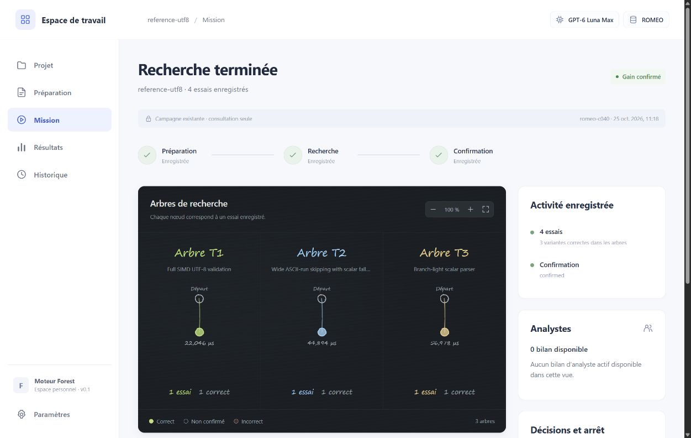

# Validation de l'application locale — 25 octobre 2026

Cette livraison fournit les cinq écrans de l'application, la conservation des projets
et la consultation des preuves Forest. Elle ne soumet pas encore de nouvelle
campagne sur ROMEO. Aucun appel à Luna ni calcul distant n'a été lancé pour cette
validation.

## Contrôles applicatifs

| Contrôle | Résultat |
| --- | --- |
| Python : `python -m pytest tests/test_webapp.py -q --tb=short` | 43 tests réussis |
| JavaScript : `node --test tests/test_web_frontend.mjs` | 6 tests réussis |
| Qualité : `python -m ruff check src tests` | Réussi |
| Distribution : `python -m build --wheel` | Réussi ; ressources statiques incluses |
| Syntaxe du lanceur PowerShell | Réussie |
| Espaces et fins de ligne : `git diff --check` | Réussi |

Les tests couvrent l'import, les limites des archives, les chemins, les contrats,
la conservation au redémarrage, les empreintes des originaux, la séparation des
projets et campagnes, les sources et diffs, la généalogie, la lecture seule et
les conditions nécessaires pour afficher un gain ou livrer du code.

La vérification HTTP utilise FastAPI TestClient. Starlette émet un avertissement
de dépréciation concernant son usage de `httpx` ; aucun test ne dépend de la
suppression de cet avertissement.

## Parcours vérifié dans le navigateur

- Importer deux fichiers par le sélecteur de fichiers.
- Bloquer la préparation lorsque le contrat est incomplet.
- Renseigner et enregistrer le contrat, puis préparer et télécharger le dossier.
- Conserver le brouillon lors d'un changement d'écran.
- Conserver les données enregistrées après redémarrage du serveur.
- Sélectionner une vraie campagne, un arbre et une variante ; lire le code et le
  diff par rapport à la référence.
- Afficher les mesures, télécharger le projet confirmé et vérifier son empreinte.
- Rechercher la campagne dans l'historique.
- Vérifier qu'un nouveau projet sans exécution n'affiche pas les résultats
  d'une ancienne campagne.
- Vérifier l'absence d'erreurs JavaScript dans la console.

Le parcours a été contrôlé sur navigateur de bureau. L'adaptation aux petites
largeurs est prévue dans les styles, mais n'a pas été vérifiée sur un appareil mobile.

Les données de démonstration de l'import ont été retirées de l'historique visible
après sauvegarde de leur base. La campagne originale est restée en lecture seule.

## Preuve réelle consultée

La campagne UTF-8 archivée `reference-utf8`, issue de ROMEO `romeo-c040`,
contient trois arbres, un essai par arbre et une intégration finale. Elle enregistre
`gpt-6-luna`, effort `max`. Ce court essai n'a aucun bilan d'analyste actif
ni décision de pilotage enregistrée ; l'interface affiche cette absence.

| Mesure archivée | Valeur |
| --- | --- |
| Référence | 49,22144766384037 µs |
| Variante confirmée | 21,82681858779802 µs |
| Accélération confirmée | 2,255090336 × |

Il s'agit des résultats déjà présents dans l'archive, pas d'une nouvelle campagne.
Le téléchargement du navigateur correspond exactement au `submission.zip`
de cette campagne :

```text
SHA-256 44299c56ae522f4f7d39cc1c46408e83b694191b29e8192ac153370562874c00
```



## Suite complète du dépôt

La commande `python -m pytest` a collecté 932 tests et produit :

```text
6 failed, 926 passed, 1 warning in 2234.94s (0:37:14)
```

Elle avait collecté 37 tests d'application ; six tests applicatifs supplémentaires
ont ensuite été ajoutés et validés dans la commande ciblée à 43 tests.
Ces nombres proviennent d'exécutions distinctes.

Les six échecs ont tous levé :

```text
InfrastructureError: Target changed; create a new campaign rather than mix measurements
```

Cas concernés :

1. `test_active_pipeline.py::test_live_loop_branches_integrates_closes_and_confirms[False-True]`
2. `test_active_pipeline.py::test_live_loop_branches_integrates_closes_and_confirms[True-False]`
3. `test_active_pipeline.py::test_live_loop_branches_integrates_closes_and_confirms[True-True]`
4. `test_finish_started.py::test_unknown_usage_does_not_interrupt_repair_or_final_integration`
5. `test_pairwise_mother.py::test_parallel_forest_then_measured_pairs_in_original_mother_and_final_confirmation[5]`
6. `test_pairwise_mother.py::test_pair_repair_continues_same_thread_without_extra_fusion_slot`

Le contrôle d'identité dans `evaluator.target_identity` inclut l'empreinte de
**tous les fichiers Python du paquet**, y compris la nouvelle application.
Des retouches de ces fichiers pendant la longue exécution ont invalidé les
campagnes de test. Sur les six campagnes en échec examinées, le seul champ
différent est `controller_implementation` ; les champs matériels sont identiques.

Il s'agit d'une perturbation de la validation par les modifications de fichiers
effectuées pendant les tests. Elle ne démontre pas un défaut du matériel ni une
régression des décisions d'arrêt. Le contrôle de cohérence a été conservé.

La relance des six cas, sans retouche des sources pendant leur exécution, a réussi :

```text
6 passed in 575.33s (0:09:35)
```

Aucun test ni contrôle d'identité n'a été assoupli pour obtenir ce résultat.
Les 932 tests collectés par la suite globale sont ainsi passés, dont six lors
de cette seconde exécution. Les 43 tests Python applicatifs et les six tests
JavaScript ont également réussi dans leurs commandes ciblées distinctes.

Pour toute campagne réelle, conserver une installation du moteur figée pendant
l'exécution. Modifier les sources d'une installation éditable peut invalider sa
reprise, même si les changements concernent seulement l'interface.

## Limites de cette livraison

- La préparation produit un dossier d'entrée ; le profil exécutable, le
  superviseur distant et la soumission SLURM restent à raccorder.
- Le contrat fixe GPT-6 Luna, effort max, ROMEO et une mémoire neuve pour le futur
  lancement. Il ne prouve pas une exécution autonome.
- La vue des analystes présente le dernier bilan actif disponible par arbre.
  Les anciens rapports d'observation restent accessibles dans le rapport natif.
- La consultation des sources est bornée ; les limites sont décrites dans
  [la documentation de l'application](APPLICATION.md).
- Le lot d'interface ne modifie pas les décisions du planificateur. Les modifications
  du moteur déjà présentes dans le dossier de travail ont été conservées.

