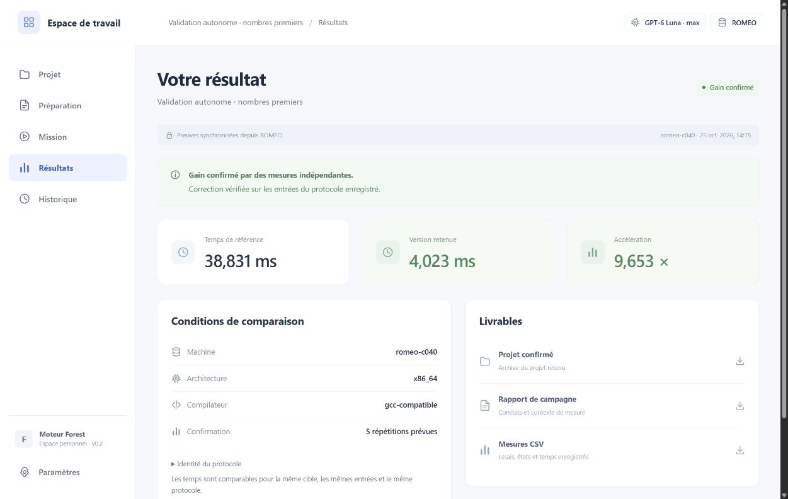

# Validation du parcours autonome — 25 octobre 2026

Le parcours a été exécuté depuis l'interface locale : dépôt d'un dossier C++,
contrat sauvegardé, lancement, suivi, résultat et téléchargement. Le contrôleur
Forest et son client Codex OAuth ont tourné dans l'allocation ROMEO. L'inférence
est hébergée par OpenAI ; le PC n'a pas relayé les appels.

## Exécution réelle

| Vérification | Job ROMEO | Résultat |
|---|---:|---|
| Optimisation du projet déposé | 784095 | COMPLETED, code 0, 237 secondes |
| Appels natifs Sol 6.1 et Astra | 784096 | COMPLETED, code 0, 9 secondes |
| Recompilation du ZIP téléchargé | 784097 | COMPLETED, code 0, 16 cas corrects |

Machine : `romeo-c040`, CPU x86_64, GCC 14.2.0. L'optimisation utilise deux
cœurs alloués, dont un seul pour les mesures, et 8 Gio de mémoire. Les autres
jobs sont de petites vérifications indépendantes.

Le projet de départ calcule la somme des nombres premiers. Ses commandes,
sources et tests sont conservés dans
[le dossier de preuves](../experiments/application-autonome-20261025/README.md).
Seul `main.cpp` est modifiable. Aucun candidat optimisé ni instruction de
stratégie n'a été injecté par l'assistant pendant la recherche.

| Mesure confirmée | Valeur |
|---|---:|
| Référence | 38,8305616565 ms |
| Programme retenu | 4,0226105601 ms |
| Accélération | 9,6530750558 × |
| Répétitions de confirmation | 5 |

La mesure inclut la commande complète, avec le lancement du programme. Elle
illustre le raccordement de l'application ; ce n'est pas une nouvelle campagne
SGEMM, UTF-8 ou Mandelbrot, ni une comparaison générale entre modèles.

La mission `ef67876d343b44979c70a5ece22f593c` utilise **GPT-6 Luna / max**.
Elle a enregistré trois arbres, un candidat correct par arbre et une intégration
G correcte. L'arrêt enregistré est `budget_exhausted` : la réserve conservatrice
de confirmation peut fermer la recherche avant la durée choisie (ici 10 minutes).
Ce test court ne contient **aucun bilan d'analyste actif ni décision de pilotage**.
Il ne prouve donc pas une intervention réelle de ces rôles pendant ce parcours.

## Autres modèles

Les sélecteurs proposent GPT-6 Luna, GPT-6.1 Sol et GPT-6 Astra. Luna accepte
`low`, `medium`, `high`, `xhigh`, `max` ; Sol et Astra proposent aussi `ultra`.
Le catalogue a été confronté au cache du client Codex 0.164.0 de ROMEO.
Le choix est figé pour tous les rôles d'une même mission.

Des réponses JSON structurées réelles ont été obtenues par le client natif,
avec OAuth directement sur le nœud : Sol 6.1 / low en 4,179 s et Astra / high
en 3,482 s. Ces deux sondes vérifient l'accès aux modèles, **pas** une optimisation
complète avec chacun d'eux. Les 17 associations proposées modèle/effort sont
vérifiées localement dans les requêtes, les canaux et les arguments du client.

## Indépendance du PC et livraison

Le serveur local a été arrêté à `2026-10-25T13:17:53.8519333Z` pendant la recherche.
ROMEO a continué : une progression distante postérieure à l'arrêt a comptabilisé
49 262 tokens, contre 36 925 dans l'observation précédente. Au redémarrage,
l'application a retrouvé le même job 784095 et a récupéré son résultat, sans
seconde soumission.

Le ZIP a été téléchargé en cliquant dans l'interface, puis ses octets ont été
renvoyés sur ROMEO pour recompilation et vérification indépendante. Les tests
et le README sont identiques aux originaux ; la disposition des fichiers est
restaurée. Le manifeste livré indique le modèle, l'effort, le protocole et la
mesure retenue.

SHA-256 du ZIP :
`f0e1eacb0ba94d2f1a0cd36fc205ee1d2dc0bc85e5b3bcbe2878e6cd6c22dd21`.

SHA-256 du paquet moteur et entrées transféré pour le job 784095 :
`edbef9bc8a74a6f930a3f7056da709e18d9f6f5d6480151e750ae1fba0ddf1d7`.

Le rapport original est conservé. Une correction de présentation précise que
la confirmation réexécute la commande de test fournie ; elle n'invente pas
d'autres cas de correction. Les mesures, le registre et le ZIP restent inchangés.
Les corrections finales d'historique, de présentation et de lecture sous Windows
sont vérifiées localement, sans refaire la campagne de performance.

## Vérifications locales

La suite initiale de **952 cas** a été exécutée en deux ensembles disjoints :
133 réussites / 1 échec, puis 805 réussites / 13 échecs. Ces premiers passages
n'étaient donc pas entièrement verts. Les échecs ont été traités :

- douze anciens cas utilisaient des requêtes simulées sans identité de modèle ;
  leurs fixtures renseignent désormais explicitement modèle et effort ;
- une lecture concurrente de fichier échouait sous Windows ; une reprise brève
  et bornée traite le verrou temporaire, sans masquer un refus persistant ;
- un contrôle de sanitizer avait accepté le programme incorrect. L'analyse a
  révélé un chemin où l'expiration du contrôle était ignorée. Elle provoque
  désormais une erreur d'infrastructure : la correction reste non vérifiée.

Après corrections, **114 tests ciblés passent**, puis **7 tests de gestion des
appels longs passent**. Ces relances couvrent tous les échecs initiaux et les six
nouveaux cas de régression, soit **958 cas couverts au total** avec les autres
tests déjà réussis. Il s'agit d'une suite complète suivie de relances ciblées,
pas d'un second passage intégral des 958 cas.

Les **6 tests JavaScript**, la vérification de syntaxe de l'interface et
**Ruff** passent. Le paquet wheel est construit et son installation extraite
est vérifiée séparément : imports, fichiers statiques, trois modèles et modules
distants. L'avertissement de dépréciation `httpx` / Starlette reste non bloquant.

Dans le navigateur : dépôt réel de dossier, sauvegarde des choix, restauration
du brouillon Sol / ultra après navigation, retour à Luna / max, lancement,
reprise après fermeture, consultation du code et du diff, filtre de l'historique
et téléchargement des trois livrables ont été vérifiés.

Les tests simulés n'allouent aucun job et n'appellent aucun modèle.
Les [résultats de validation](../experiments/application-autonome-20261025/validation.json)
et le journal des relances conservent les comptes et leurs limites.

## Limites vérifiées

- Le parcours réel couvre CPU x86_64. Le GPU est désactivé sans profil ARM
  configuré et n'a pas été validé ici.
- La reprise démontrée concerne le suivi et la récupération après fermeture
  du PC. Panne du nœud, expiration OAuth et limite SLURM ne déclenchent pas
  de nouvelle allocation automatique.
- Le contrat de compilation, de correction et de mesure doit être renseigné.
  La réussite des tests ne démontre que la couverture fournie par ce contrat.
- Le budget, les réserves et la politique d'arrêt du moteur continuent de
  s'appliquer ; l'application ne garantit ni gain ni nombre d'itérations.

Voir [le fonctionnement et la configuration](APPLICATION.md).
