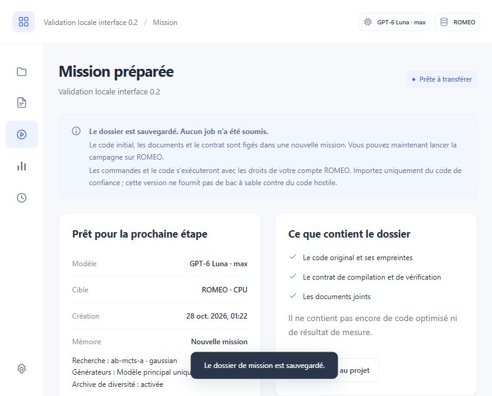

# Validation de la stabilisation Forest 0.2

Date : 28 octobre 2026. Point de retour :
`4f6bd15f011511fb7ea93b1ac939aca2f9a81e56`.

## Résultat fonctionnel

Un seul produit Forest, Luna Max par défaut, mélange de générateurs désactivé.
Le conseiller TabPFN n'entre plus dans la configuration courante, la sélection,
l'ordonnancement, les bundles, l'interface ni les dépendances. Mother, les
analystes, la mémoire de preuves, l'archive de diversité et TreeQuest restent.
La lecture d'un historique n'en modifie pas le contrat.

Les cinq modules et six fichiers de tests retirés sont conservés octet pour
octet avec manifeste. La comparaison avec le commit de retour valide les onze
fichiers. Les 72 cas de test spécifiques au conseiller quittent la suite produit ;
23 cas nouveaux vérifient le retrait, la conservation des données, les écritures
concurrentes, les sauvegardes, la migration et l'arrêt. Les tests de correction
des campagnes et les résultats scientifiques archivés n'ont pas été modifiés.

## Contrôles

| Contrôle | Résultat | Preuve |
|---|---|---|
| Suite Python complète puis reprise ciblée | 1 114 cas validés, 3 ignorés, aucun échec restant | [Reçu consolidé](../evidence/stabilization-20261028/result.json), [passage complet](../evidence/stabilization-20261028/full-run.log), [reprise](../evidence/stabilization-20261028/study-recheck.log) |
| Ruff sur src, tests et tools | Réussi | [Journal](../evidence/stabilization-20261028/ruff-final.log) |
| JavaScript | 9 réussis | [Journal](../evidence/stabilization-20261028/javascript.log) |
| Lot persistance, migration, arrêt et application | 36 réussis | `artifacts/stabilization-short-path.log` |
| Tests contre la wheel installée, hors imports du checkout | 28 réussis | [Journal](../evidence/stabilization-20261028/installed-wheel-tests.log), [JUnit](../evidence/stabilization-20261028/installed-wheel-tests.xml) |
| Import ZIP, document, contrat, préparation, téléchargement, migration dans le navigateur | Réussi, aucune mission soumise | [Reçu](../evidence/stabilization-20261028/browser.json) |
| Installation neuve, redémarrage et `pip check` | Réussi, 11 enregistrements préservés, verrou interprocessus vérifié | [Reçu](../evidence/stabilization-20261028/installation.json) |
| Wheel | 119 fichiers identiques aux sources ; deux fabrications octet pour octet identiques ; aucun module advisor | [Reçu](../evidence/stabilization-20261028/build.json) |
| Sauvegarde et consolidation réelles | Deux stockages vérifiés, une variante de contrat conservée | [Reçu](../evidence/stabilization-20261028/consolidation.json) |
| CI Windows et Linux | Configurée, pas exécutée sur le service | [Workflow](../.github/workflows/validation.yml) |
| Nouveau calcul ROMEO ou GPU | Aucun | Les anciennes mesures restent attribuées à leur moteur figé |

La validation du paquet comprend le moteur de bout en bout avec compilation
locale et les scénarios d'application avec connecteur simulé. Elle n'appelle
aucun modèle hébergé et ne soumet aucun job. Deux tests d'arrêt exécutent la vraie
politique TreeQuest, terminent les deux essais engagés et vont jusqu'à la
confirmation, avec architectures active et indépendante.

Le passage complet dure 1 569 secondes : 1 113 réussites, trois exclusions et
un échec d'import dans un test du plan historique. Ce test importait le runtime
retiré uniquement pour lire `CONDITIONS` et calculer un manifeste. Il lit
désormais cette constante avec `ast.literal_eval` et recalcule les SHA-256 sans
exécuter le script archivé. Les assertions de budgets, ordres et intégrité restent
identiques ; aucun fichier d'expérience n'est modifié. Les cinq tests de ce module
ont ensuite tous réussi. Le reçu consolide ces deux passages sans effacer l'échec
initial. La suite complète n'a pas été relancée après cette correction de test ;
les 119 fichiers produit sont restés identiques pendant toute la validation.

Les exclusions sont les deux contrôles de relocalisation utilisant des liens
symboliques POSIX sous Windows, et le sampler optionnel `sakana-m` non installé.
Le passage complet signale aussi une dépréciation HTTPX de Starlette ; les tests
API réussissent dans l'environnement figé.

L'installation utilise Python 3.13.12 et les 52 dépendances du verrou Windows,
incluant le backend de fabrication. Les deux wheels comparées sont produites dans
des répertoires neufs avec les mêmes sources et `SOURCE_DATE_EPOCH`. Cette preuve
ne prétend pas que toutes les plateformes ou tous les outils produisent les mêmes
octets, ni que les archives sdist sont identiques.

Le test navigateur utilise un stockage dédié sans configuration ROMEO. Le ZIP
téléchargé correspond exactement au dossier figé, avec deux sources et un
document dont les SHA-256 sont vérifiés. La migration est testée sur une fixture
historique : l'ancienne identité et sa préparation sont conservées. Aucune erreur
de console n'a été relevée sur ce parcours. Les téléchargements et les résultats
des missions historiques ont également été ouverts dans l'application regroupée.

## Conservation des données locales

L'application utilise désormais `C:/Users/nicol/.hpc-forest/application` et le
runtime isolé `C:/Users/nicol/.hpc-forest/runtime-0.2`. Les anciennes instances des
ports 8767 et 8768 étaient toutes deux sans mission active. Elles ont été arrêtées
avant sauvegarde ; leurs répertoires d'origine restent intacts.

Les sauvegardes vérifiées se trouvent dans
`C:/Users/nicol/.hpc-forest/backups/stabilization-20261028/`. La consolidation
conserve trois projets, trois préparations, deux missions terminées et trois
campagnes. La seule différence de contrat est conservée dans un projet distinct,
avec filiation et fichiers vérifiés. Les deux vues internes sont reliées à leurs
copies identiques ; la troisième campagne reste liée à son dossier externe,
également sauvegardé. Ses chemins Git sont conservés tels quels : sa copie n'est
pas présentée comme un ensemble de worktrees relocalisés et exécutables.

## Défauts rencontrés et limites

Les essais ont conduit à corriger la synchronisation de fichiers sous Windows,
les remplacements momentanément refusés par le système et les chemins temporaires
trop longs lors de l'extraction des bundles. La fabrication isolée a révélé
l'absence du backend setuptools dans l'ancien environnement : le verrou de
dépendances inclut maintenant aussi les exigences de fabrication.

Une restauration ne relance jamais une mission inachevée. L'opérateur doit
réconcilier son job existant. L'arrêt propre attend les travaux engagés ; il ne
garantit pas un délai fixe ni la survie à une panne du nœud. Les codes s'exécutent
sous le compte ROMEO, sans isolement OS contre du code hostile.

Le profil Linux et la CI restent à exécuter. Aucun nouveau chiffre de performance
HPC n'est attribué à cette version. Les droits de diffusion du projet, des
programmes importés et d'une éventuelle offre commerciale restent à établir dans
les [notices](THIRD-PARTY-NOTICES.md). La livraison locale n'est pas une publication.
