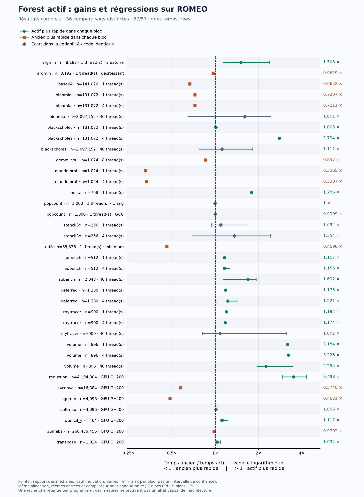
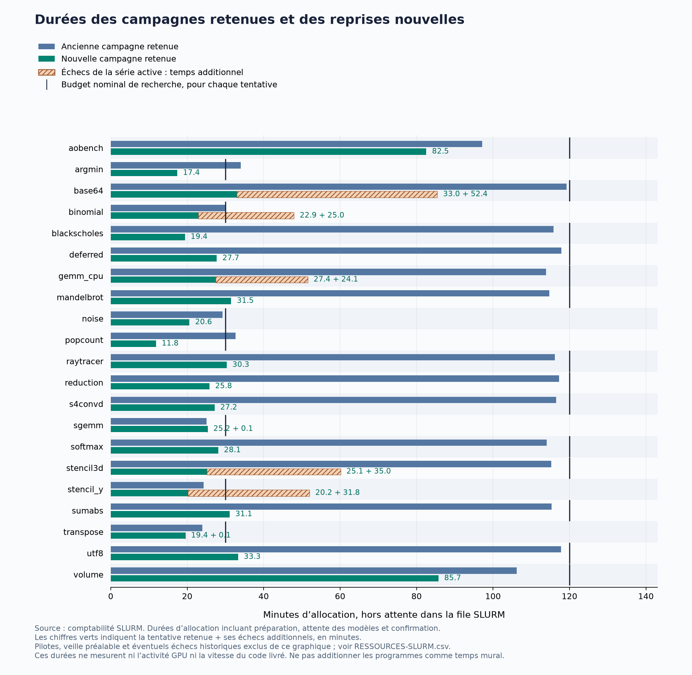

# Forest actif — résultats ROMEO

21 / 21 nouvelles campagnes terminées ; 57 / 57 lignes documentaires remesurées ; 5 observations du tableau restent non exécutables faute de source ou de données exactes.

Les speedups de cette campagne emploient un même naïf, dans une même allocation ROMEO, pour la référence publiée remesurée, l’ancien programme Forest et le nouveau. Les speedups publiés restent affichés séparément : ils proviennent d’autres matériels et parfois d’autres versions de compilateur ou d’exemple. Aucun facteur théorique de puissance matérielle n’est appliqué.

Moteur testé : `d666ea79404b1944ba1abacd126ccaacb0482d53` ; **878 tests réussis**, aucun échec ni test ignoré, Ruff et contrôle du diff validés. Les fichiers exécutés sur ROMEO correspondent octet pour octet au moteur figé.

[Diagnostic détaillé par programme](ANALYSE.md) : décisions, coûts, combinaisons et lecture des sources.

[Classeur Excel filtrable](COMPARAISON-ROMEO.xlsx) : speedups calculés par formules, temps, arbres, décisions, chronologie et ressources. Les CSV et JSON restent les données complètes.

## Protocole et portée

- GPT-6 Luna, effort max, pour tous les rôles. Mêmes sources initiales, entrées et tests protégés que les campagnes précédentes.
- Mémoire, registre et session neufs par programme ; aucun ancien candidat injecté dans la recherche. Les anciens candidats servent uniquement à la remesure après sélection.
- 14 programmes conservent le budget précédent de 7 200 s ; les 7 autres conservent 1 800 s. La réserve finale et la règle de fin des travaux déjà admis restent applicables.
- Les appels au modèle passent par le relais local et le service Codex ; les poids de Luna ne sont pas hébergés sur ROMEO. La recherche, la compilation, les contrôles et les mesures des programmes s’exécutent sur ROMEO.
- GPU GH200 pour CUDA/Triton ; CPU AMD EPYC 9654 pour les codes CPU. Les sources old/new sont remesurées dans le même job, avec les mêmes entrées et un ordre alterné déterministe.
- 9 blocs de mesure pour les cas GPU, 7 pour les cas CPU et de rendu. Les contrôles supplémentaires sont conservés séparément des temps.
- Une recherche complète retenue par programme : les répétitions de chronométrage mesurent le bruit temporel, pas la variabilité de la recherche. N est choisi par Mother ; un résultat ne démontre pas à lui seul un effet causal de l’architecture.

## Interventions et indépendance des recherches

L’opérateur a préparé les contrats et lanceurs, corrigé les défauts révélés par les pilotes et relancé les échecs techniques documentés. Le moteur des campagnes comparées est ensuite resté figé. Aucun ancien candidat optimisé, conseil algorithmique issu des comparaisons ou correction manuelle d’un candidat n’a été fourni aux modèles pendant ces recherches. La lecture comparative des sources a été faite après la livraison de chaque programme.

Les relances après échec technique augmentent le coût total. Le budget nominal identique concerne chaque tentative ; une comparaison à coût total strictement égal devrait également déduire le coût de ces échecs. Ce dossier conserve les deux comptes et retient la première tentative complète, sans choisir selon son speedup.

## Boucle active observée

Ces décisions ont été appliquées pendant les recherches retenues, avec des appels Luna réels. Les tests logiciels vérifient aussi les conditions de rejet et de reprise. Une décision appliquée ne démontre pas un gain : ses descendants doivent encore être mesurés.

| Action | Occurrences appliquées | Programmes concernés |
|---|---:|---:|
| continue | 84 | 19 |
| suspend | 84 | 21 |
| resume | 3 | 3 |
| branch | 5 | 4 |
| share | 8 | 6 |
| integrate | 29 | 18 |
| close | 14 | 14 |

## Ce qui est réinitialisé

Chaque tentative de recherche crée une session et un registre vides. À l’intérieur d’une même recherche, Mother conserve sa conversation et les arbres conservent leur historique : cette continuité fait partie du système. Les analystes reçoivent des instantanés bornés de leur arbre, dans des appels isolés. Les reprises documentées repartent du code initial et ne récupèrent aucun candidat de la tentative échouée.

Dans les remesures appariées, chaque combinaison variante / entrée / bloc lance un nouveau processus pilote. Ses appels de correction, d’échauffement et de chronométrage réutilisent ensuite ce processus et ses allocations. Les répétitions chronométrées ne correspondent donc pas à des démarrages à froid indépendants. Softmax emploie le protocole triton.testing.do_bench ; les autres suites GPU utilisent des événements CUDA avec synchronisation, et les pilotes CPU chronomètrent leurs répétitions après échauffement.

Il n’y a pas de redémarrage du nœud, de remise à zéro globale du GPU ou de purge globale des caches système entre deux variantes. Les caches de fichiers ou de compilation, les fréquences et la température peuvent persister. L’ordre alterné, les répétitions et les mesures dans la même allocation limitent certains biais, sans supprimer ces effets matériels. Les timings ne mesurent pas le coût complet de démarrage ou de compilation à froid.

Les tailles d’entrée sont conservées ligne par ligne. Pour AOBench, Binomial et Black-Scholes, les lignes historiques à 40 threads emploient une taille plus grande que celles à 1 ou 4 threads. Leurs temps bruts ne mesurent donc pas une mise à l’échelle à problème constant. Le diagnostic indique les tailles et ne calcule cette mise à l’échelle que pour les entrées identiques.

Les cœurs sont limités par l’affinité de l’allocation SLURM, mais les nœuds CPU ne sont pas réservés exclusivement. D’autres jobs peuvent partager mémoire, alimentation et fréquences. L’ordre alterné et les blocs répétés réduisent certains biais ; ils ne garantissent pas une isolation physique parfaite.

[Durées par phase](DUREES-PHASES.csv) : compilation, contrôle, benchmark, attente de verrou et appels modèle, avec tous les échantillons disponibles. Ces phases se chevauchent ou sont imbriquées ; leurs totaux ne sont pas additifs.

## Niveau atteint face aux références du tableau

Pour chaque entrée et chaque allocation, on retient la référence remesurée la plus rapide parmi les lignes documentaires comparables, avec le même agrégat temporel. Cette comparaison évite de compter comme une réussite le seul dépassement d’une référence intermédiaire plus lente. Elle ne prétend pas couvrir toutes les implémentations existantes.

| Constat face à cette référence | Configurations mesurées |
|---|---:|
| Forest dépasse la référence dans chaque bloc | 13 |
| Référence plus rapide dans chaque bloc | 19 |
| Écart dans la variabilité observée | 4 |

[Détail par entrée, matériel et référence](REFERENCES-LES-PLUS-RAPIDES.csv). Les répétitions ne sont pas des recherches indépendantes ; les agrégats suivent le protocole, dont le minimum pour la ligne UTF-8 BEST.

## Comparaison

[Graphique vectoriel](GAINS-REGRESSIONS.svg) · [PDF](GAINS-REGRESSIONS.pdf). Une ligne par comparaison distincte ; les barres montrent la plage des blocs.

Les 57 lignes remesurées correspondent à 36 comparaisons ancien/nouveau distinctes. Plusieurs références documentaires peuvent partager le même couple de candidats et les mêmes entrées ; leurs lignes ne constituent pas des réplications indépendantes.

Sur ces configurations distinctes : **17 gains dans chaque bloc**, **11 régressions dans chaque bloc**, 6 résultats mixtes et 2 cas avec le même code ou binaire. Il n’y a donc pas d’amélioration systématique. Les tailles d’entrée et nombres de threads d’un même programme restent liés ; ces comptes ne sont pas des recherches indépendantes.

| Observation | Publié | Référence sur ROMEO | Ancien Forest, remesuré | Forest actif | Actif / ancien | Conclusion |
|---|---:|---:|---:|---:|---:|---|
| CPU_ISPC_AO_1C | 6.19 | 7.255 | 1.567 | 1.813 | 1.157 | Nouveau plus rapide dans chaque bloc |
| CPU_ISPC_AO_4C | 28.06 | 14.27 | 6.241 | 7.215 | 1.156 | Nouveau plus rapide dans chaque bloc |
| CPU_ISPC_BINOMIAL_1C | 7.94 | 4.705 | 6.948 | 5.008 | 0.7207 | Ancien plus rapide dans chaque bloc |
| CPU_ISPC_BINOMIAL_4C | 33.43 | 18.65 | 27.61 | 19.91 | 0.7211 | Ancien plus rapide dans chaque bloc |
| CPU_ISPC_BLACKSCHOLES_1C | 8.45 | 9.709 | 1.047 | 1.053 | 1.005 | Nouveau plus rapide dans chaque bloc |
| CPU_ISPC_BLACKSCHOLES_4C | 32.48 | 33.33 | 4.176 | 11.67 | 2.794 | Nouveau plus rapide dans chaque bloc |
| CPU_ISPC_DEFERRED_1C | 5.02 | 7.208 | 1.003 | 1.176 | 1.173 | Nouveau plus rapide dans chaque bloc |
| CPU_ISPC_DEFERRED_4C | 23.06 | 23.17 | 3.308 | 4.038 | 1.221 | Nouveau plus rapide dans chaque bloc |
| CPU_ISPC_MANDELBROT_1C | 6.21 | 9.264 | 11.49 | 3.752 | 0.3265 | Ancien plus rapide dans chaque bloc |
| CPU_ISPC_MANDELBROT_4C | 20.28 | 36.79 | 45.03 | 14.89 | 0.3307 | Ancien plus rapide dans chaque bloc |
| CPU_ISPC_PERLIN_1C | 5.37 | 9.902 | 1.187 | 2.12 | 1.786 | Nouveau plus rapide dans chaque bloc |
| CPU_ISPC_RAYTRACER_1C | 4.31 | 6.062 | 1.001 | 1.193 | 1.192 | Nouveau plus rapide dans chaque bloc |
| CPU_ISPC_RAYTRACER_4C | 20.29 | 23.1 | 3.839 | 4.506 | 1.174 | Nouveau plus rapide dans chaque bloc |
| CPU_ISPC_STENCIL_1C | 4.05 | 4.799 | 5.436 | 5.945 | 1.094 | Écart dans la variabilité observée |
| CPU_ISPC_STENCIL_4C | 15.53 | 13.15 | 9.134 | 12.37 | 1.354 | Écart dans la variabilité observée |
| CPU_ISPC_VOLUME_1C | 3.6 | 2.868 | 1.349 | 4.294 | 3.184 | Nouveau plus rapide dans chaque bloc |
| CPU_ISPC_VOLUME_4C | 17.53 | 11.43 | 5.31 | 17.13 | 3.226 | Nouveau plus rapide dans chaque bloc |
| CPU_ISPC_AO_40C | 182.4 | 102.8 | 34.99 | 59.21 | 1.692 | Nouveau plus rapide dans chaque bloc |
| CPU_ISPC_BINOMIAL_40C | 63.85 | 97.08 | 46.13 | 73.84 | 1.601 | Écart dans la variabilité observée |
| CPU_ISPC_BLACKSCHOLES_40C | 83.97 | 152.2 | 3.392 | 3.77 | 1.111 | Écart dans la variabilité observée |
| CPU_ISPC_RAYTRACER_40C | 195.7 | 39.85 | 11.77 | 12.73 | 1.081 | Écart dans la variabilité observée |
| CPU_ISPC_VOLUME_40C | 243.2 | 103.3 | 51.8 | 116.8 | 2.254 | Nouveau plus rapide dans chaque bloc |
| CPU_POPCOUNT_CLANG | 21.42 | 16.42 | 16.42 | 16.42 | 1 | Code ou binaire identique : variation de mesure |
| CPU_POPCOUNT_GCC | 16.27 | 12.79 | 12.79 | 12.79 | 0.9999 | Code ou binaire identique : variation de mesure |
| CPU_BASE64_SCALAR | 9.857 | 9.567 | 9.216 | 6.13 | 0.6652 | Ancien plus rapide dans chaque bloc |
| CPU_BASE64_CHROMIUM | 8.762 | 6.958 | 6.703 | 4.458 | 0.6652 | Ancien plus rapide dans chaque bloc |
| CPU_UTF8_BEST | 24.48 | 4.859 | 3.405 | 1.565 | 0.4598 | Ancien plus rapide dans chaque bloc |
| CPU_UTF8_MEAN | 22.69 | 4.871 | 3.419 | 1.557 | 0.4554 | Ancien plus rapide dans chaque bloc |
| CPU_ARGMIN_RANDOM | 14.44 | 2.65 | 9.682 | 14.6 | 1.508 | Nouveau plus rapide dans chaque bloc |
| CPU_ARGMIN_DECREASING | 10.21 | 2.396 | 9.117 | 8.779 | 0.9629 | Ancien plus rapide dans chaque bloc |
| CPU_BOEHM_DEFAULT_FINAL | 280.1 | 26.06 | 1337 | 1145 | 0.857 | Ancien plus rapide dans chaque bloc |
| CPU_BOEHM_O3_FINAL | 101.3 | 40.67 | 2086 | 1787 | 0.857 | Ancien plus rapide dans chaque bloc |
| CPU_BOEHM_O3_REORDER | 18.21 | 75.99 | 2086 | 1787 | 0.857 | Ancien plus rapide dans chaque bloc |
| CPU_BOEHM_O3_TILING | 23.16 | 79.6 | 2086 | 1787 | 0.857 | Ancien plus rapide dans chaque bloc |
| gpu_sgemm_02 | 6.429 | 12.62 | 48.01 | 23.19 | 0.4831 | Ancien plus rapide dans chaque bloc |
| gpu_sgemm_03 | 9.645 | 18.4 | 48.01 | 23.19 | 0.4831 | Ancien plus rapide dans chaque bloc |
| gpu_sgemm_04 | 27.43 | 33.97 | 48.01 | 23.19 | 0.4831 | Ancien plus rapide dans chaque bloc |
| gpu_sgemm_05 | 51.69 | 51.78 | 48.01 | 23.19 | 0.4831 | Ancien plus rapide dans chaque bloc |
| gpu_sgemm_07 | 52.47 | 56.22 | 48.01 | 23.19 | 0.4831 | Ancien plus rapide dans chaque bloc |
| gpu_sgemm_08 | 53.27 | 46.53 | 48.01 | 23.19 | 0.4831 | Ancien plus rapide dans chaque bloc |
| gpu_sgemm_11 | 55.92 | 75.63 | 48.01 | 23.19 | 0.4831 | Ancien plus rapide dans chaque bloc |
| gpu_sgemm_06 | 59.02 | 62.66 | 48.01 | 23.19 | 0.4831 | Ancien plus rapide dans chaque bloc |
| gpu_sgemm_09 | 63.82 | 62.34 | 48.01 | 23.19 | 0.4831 | Ancien plus rapide dans chaque bloc |
| gpu_sgemm_10 | 70.48 | 71.4 | 48.01 | 23.19 | 0.4831 | Ancien plus rapide dans chaque bloc |
| gpu_sgemm_cublas | 75.24 | 99.5 | 48.01 | 23.19 | 0.4831 | Ancien plus rapide dans chaque bloc |
| gpu_reduce_02 | 2.33 | 1.4 | 1.667 | 5.833 | 3.498 | Nouveau plus rapide dans chaque bloc |
| gpu_reduce_03 | 4.68 | 1.499 | 1.667 | 5.833 | 3.498 | Nouveau plus rapide dans chaque bloc |
| gpu_reduce_04 | 8.34 | 2.439 | 1.667 | 5.833 | 3.498 | Nouveau plus rapide dans chaque bloc |
| gpu_reduce_05 | 15.01 | 2.527 | 1.667 | 5.833 | 3.498 | Nouveau plus rapide dans chaque bloc |
| gpu_reduce_06 | 21.16 | 2.527 | 1.667 | 5.833 | 3.498 | Nouveau plus rapide dans chaque bloc |
| gpu_reduce_07 | 30.04 | 3.203 | 1.667 | 5.833 | 3.498 | Nouveau plus rapide dans chaque bloc |
| gpu_transpose_m2050 | 5.293 | 4.952 | 4.961 | 5.13 | 1.034 | Nouveau plus rapide dans chaque bloc |
| gpu_transpose_k20c | 2.609 | 4.952 | 4.961 | 5.13 | 1.034 | Nouveau plus rapide dans chaque bloc |
| gpu_stencil_y | 1.67 | 0.8823 | 1.04 | 1.162 | 1.117 | Nouveau plus rapide dans chaque bloc |
| gpu_softmax_triton | 4.154 | 4.751 | 5.125 | 5.157 | 1.006 | Écart dans la variabilité observée |
| gpu_bvh_traversal | 15 | — | — | — | — | Non exécutable : source ou données exactes manquantes |
| gpu_bvh_hierarchy | 50 | — | — | — | — | Non exécutable : source ou données exactes manquantes |
| gpu_sum_abs_fusion | 3 | 2.747 | 4.352 | 4.261 | 0.9792 | Ancien plus rapide dans chaque bloc |
| gpu_s4convd_kernels | 3.26 | 6.264 | 7.632 | 4.385 | 0.5746 | Ancien plus rapide dans chaque bloc |
| gpu_s4convd_epoch | 1.29 | — | — | — | — | Non exécutable : source ou données exactes manquantes |
| CPU_MIT_PYTHON_AVX | 5.329e+04 | — | — | — | — | Non exécutable : source ou données exactes manquantes |
| CPU_MIT_C_AVX | 2964 | — | — | — | — | Non exécutable : source ou données exactes manquantes |

Le rapport entre le temps ancien et le temps nouveau est supérieur à 1 lorsque le nouveau programme est plus rapide. Si les sources ou les binaires sont identiques, la différence est classée comme variation de mesure. Les plages par bloc et coefficients de variation sont dans le CSV.

## Détail des campagnes

| Programme | Arbres initiaux → créés | Essais corrects / total | Analyse + pilotage | Durée réelle / budget (s) | G confirmé |
|---|---:|---:|---:|---:|---|
| aobench | 3 → +1 | 12 / 12 | 10 appels ; 7 actions | 4947 / 7200 | True |
| argmin | 3 → +2 | 18 / 18 | 21 appels ; 12 actions | 1032 / 1800 | True |
| base64 | 3 → +1 | 12 / 15 | 22 appels ; 12 actions | 1974 / 7200 | True |
| binomial | 4 → +1 | 15 / 15 | 9 appels ; 7 actions | 1369 / 1800 | True |
| blackscholes | 3 → +2 | 23 / 23 | 21 appels ; 16 actions | 1153 / 7200 | True |
| deferred | 3 → +3 | 17 / 18 | 13 appels ; 11 actions | 1644 / 7200 | True |
| gemm_cpu | 2 → +2 | 13 / 13 | 14 appels ; 11 actions | 1639 / 7200 | True |
| mandelbrot | 3 → +4 | 23 / 24 | 32 appels ; 21 actions | 1873 / 7200 | True |
| noise | 3 → +1 | 14 / 15 | 7 appels ; 6 actions | 1228 / 1800 | True |
| popcount | 3 → +1 | 15 / 15 | 10 appels ; 5 actions | 702.6 / 1800 | True |
| raytracer | 4 → +3 | 31 / 33 | 26 appels ; 11 actions | 1803 / 7200 | True |
| reduction | 3 → +1 | 14 / 14 | 14 appels ; 9 actions | 1527 / 7200 | True |
| s4convd | 3 → +2 | 13 / 13 | 16 appels ; 9 actions | 1609 / 7200 | True |
| sgemm | 3 → +2 | 18 / 18 | 20 appels ; 15 actions | 1505 / 1800 | True |
| softmax | 3 → +1 | 17 / 17 | 22 appels ; 10 actions | 1668 / 7200 | True |
| stencil3d | 3 → +3 | 21 / 21 | 25 appels ; 16 actions | 1502 / 7200 | True |
| stencil_y | 3 → +0 | 16 / 17 | 19 appels ; 9 actions | 1207 / 1800 | True |
| sumabs | 3 → +2 | 22 / 22 | 21 appels ; 12 actions | 1859 / 7200 | True |
| transpose | 2 → +0 | 11 / 11 | 14 appels ; 7 actions | 1154 / 1800 | True |
| utf8 | 3 → +1 | 19 / 21 | 24 appels ; 14 actions | 1980 / 7200 | True |
| volume | 3 → +1 | 17 / 17 | 16 appels ; 7 actions | 5134 / 7200 | True |

## Ancienne et nouvelle recherche, côte à côte

| Programme | Arbres initiaux ancien → actif | Essais corrects / total, ancien → actif | Durée réelle ancien → actif (s) | Combinaisons Gm | Essais avec avis |
|---|---:|---|---:|---:|---:|
| aobench | 3 → 3 | 13 / 13 → 12 / 12 | 5816 → 4947 | 1 | 1 |
| argmin | 2 → 3 | 8 / 8 → 18 / 18 | 2016 → 1032 | 2 | 5 |
| base64 | 2 → 3 | 60 / 61 → 12 / 15 | 6930 → 1974 | 0 | 4 |
| binomial | 3 → 4 | 9 / 9 → 15 / 15 | 1777 → 1369 | 1 | 1 |
| blackscholes | 3 → 3 | 77 / 79 → 23 / 23 | 6927 → 1153 | 2 | 9 |
| deferred | 4 → 3 | 73 / 80 → 17 / 18 | 7063 → 1644 | 3 | 7 |
| gemm_cpu | 3 → 2 | 85 / 85 → 13 / 13 | 6810 → 1639 | 2 | 6 |
| mandelbrot | 2 → 3 | 58 / 59 → 23 / 24 | 6863 → 1873 | 2 | 8 |
| noise | 3 → 3 | 11 / 11 → 14 / 15 | 1733 → 1228 | 1 | 2 |
| popcount | 3 → 3 | 12 / 12 → 15 / 15 | 1937 → 702.6 | 1 | 2 |
| raytracer | 3 → 4 | 69 / 74 → 31 / 33 | 6961 → 1803 | 3 | 13 |
| reduction | 3 → 3 | 64 / 64 → 14 / 14 | 7023 → 1527 | 1 | 4 |
| s4convd | 3 → 3 | 57 / 58 → 13 / 13 | 6980 → 1609 | 2 | 2 |
| sgemm | 2 → 3 | 14 / 15 → 18 / 18 | — → 1505 | 1 | 7 |
| softmax | 2 → 3 | 51 / 51 → 17 / 17 | 6830 → 1668 | 1 | 8 |
| stencil3d | 3 → 3 | 58 / 59 → 21 / 21 | 6901 → 1502 | 2 | 8 |
| stencil_y | 3 → 3 | 21 / 23 → 16 / 17 | — → 1207 | 0 | 4 |
| sumabs | 2 → 3 | 54 / 54 → 22 / 22 | 6900 → 1859 | 2 | 9 |
| transpose | 3 → 2 | 22 / 22 → 11 / 11 | — → 1154 | 0 | 6 |
| utf8 | 2 → 3 | 63 / 63 → 19 / 21 | 7046 → 1980 | 1 | 11 |
| volume | 4 → 3 | 19 / 19 → 17 / 17 | 6356 → 5134 | 1 | 3 |

## Coût et décisions observées

| Programme | Tokens vérifiables ancien → actif | Appels sans usage connu ancien → actif | Tokens analystes et pilotage | Gm améliorant le meilleur connu / Gm mesurées | Fin de recherche |
|---|---:|---:|---:|---:|---|
| aobench | 877,806 → 1,528,459 | 0 → 0 | 371,672 | 1 / 1 | Fermeture explicite |
| argmin | 688,378 → 2,465,874 | 0 → 0 | 1,124,004 | 0 / 2 | Fermeture explicite |
| base64 | 3,920,557 → 4,695,689 | 0 → 0 | 1,929,341 | 0 / 0 | Fermeture explicite |
| binomial | 473,486 → 2,004,476 | 0 → 0 | 341,636 | 1 / 1 | Fermeture explicite |
| blackscholes | 4,375,948 → 3,380,219 | 0 → 0 | 1,138,957 | 2 / 2 | Fermeture explicite |
| deferred | 4,950,946 → 3,320,027 | 0 → 0 | 930,359 | 3 / 3 | Tous les arbres de recherche suspendus |
| gemm_cpu | 3,981,264 → 2,211,096 | 0 → 0 | 776,686 | 2 / 2 | Tous les arbres de recherche suspendus |
| mandelbrot | 3,245,934 → 4,234,462 | 0 → 0 | 2,151,481 | 2 / 2 | Fermeture explicite |
| noise | 556,795 → 2,526,778 | 0 → 0 | 318,306 | 1 / 1 | Tous les arbres de recherche suspendus |
| popcount | 655,018 → 1,845,961 | 0 → 0 | 508,351 | 0 / 1 | Fermeture explicite |
| raytracer | 3,894,426 → 6,652,546 | 0 → 0 | 2,328,845 | 3 / 3 | Fermeture explicite |
| reduction | 2,540,188 → 2,682,509 | 0 → 0 | 579,833 | 0 / 1 | Tous les arbres de recherche suspendus |
| s4convd | 3,007,268 → 1,930,904 | 0 → 0 | 607,033 | 2 / 2 | Tous les arbres de recherche suspendus |
| sgemm | 2,469,108 → 3,262,349 | 0 → 0 | 1,193,513 | 0 / 1 | Fermeture explicite |
| softmax | 2,107,520 → 2,374,253 | 0 → 0 | 1,102,415 | 0 / 1 | Tous les arbres de recherche suspendus |
| stencil3d | 3,280,136 → 3,764,602 | 0 → 0 | 1,474,607 | 1 / 2 | Fermeture explicite |
| stencil_y | 1,629,285 → 2,412,847 | 0 → 0 | 1,112,484 | 0 / 0 | Fermeture explicite |
| sumabs | 1,996,174 → 2,835,500 | 0 → 0 | 1,117,909 | 0 / 2 | Fermeture explicite |
| transpose | 1,528,385 → 2,156,999 | 0 → 0 | 861,170 | 0 / 0 | Tous les arbres de recherche suspendus |
| utf8 | 4,050,240 → 3,336,199 | 0 → 0 | 1,388,553 | 0 / 1 | Fermeture explicite |
| volume | 1,113,627 → 2,157,816 | 0 → 0 | 881,026 | 1 / 1 | Fermeture explicite |

Ces tokens décrivent le travail connu, pas un prix en euros. Les appels inconnus ne valent pas zéro. Le bilan des tentatives échouées ci-dessous s’ajoute au coût de la tentative retenue. Une combinaison peut améliorer ses propres sources tout en restant moins rapide que le meilleur code trouvé entre-temps ; le décompte Gm emploie ce meilleur connu au moment de la mesure.

Quand Mother suspend tous les arbres, la boucle termine les travaux admis puis passe à la confirmation. Dans cette version, le champ brut `budget_exhausted` peut aussi couvrir cet arrêt sans travail admissible : il ne démontre donc pas que toute la durée autorisée a été consommée. Le tableau conserve la cause observée et les durées réelles.

La somme des durées des appels modèle se chevauche avec la recherche et ne doit pas être ajoutée à la durée murale. Les compteurs historiques cumulés de Mother sont recalculés par différence dans `native_usage_normalized` ; les journaux d’origine restent intacts. Un appel sans consommation vérifiable reste inconnu.

## Fichiers de preuve

- [Comparaison complète](COMPARAISON.csv) : 62 lignes documentaires, temps, speedups, matériel, compilateur, répétitions, variabilité et limites de reproduction.
- [Campagnes](CAMPAGNES.csv), [arbres](ARBRES.csv) et [essais](ESSAIS.csv) : sujets, parents, bases, états, diagnostics et résultats.
- [Chronologie](CHRONOLOGIE.csv) : admissions, décisions et évaluations, horodatées en UTC et en secondes depuis le début de chaque recherche.
- [Appels des analystes et de Mother](APPELS-ANALYSTES-MOTHER.csv), [décisions](DECISIONS.csv) : coût, couverture, raisons, actions appliquées ou rejetées et descendants mesurés.
- [Mesures brutes](MESURES-BRUTES.csv) et [dossier JSON](RESULTATS.json) : identités, environnement et blocs de mesure.

## Essais de mise au point conservés

Les pilotes préalables ont révélé un alias dans le schéma JSON final, une priorité injuste entre analystes, un double comptage des compteurs cumulés de Mother et des champs de décision ambigus pour le modèle. Ces défauts ont été corrigés et couverts par des tests. Les pilotes touchés par les coupures SSH ou l’erreur 503 du service modèle restent des échecs d’infrastructure ; leurs résultats ne sont pas substitués aux campagnes comparées.

Windows est aussi entré en veille sur batterie le 24 octobre à 10:51:23 UTC, puis a repris à 11:58:30 UTC. Huit allocations ont perdu leur relais local. Les six campagnes principales concernées ont été relancées avec le même moteur, des sessions neuves et sans reprise des candidats. Les deux autres étaient des pilotes.

Le [registre des tentatives préalables](TENTATIVES-PREALABLES.csv) conserve 22 allocations exclues de la comparaison : 1.918e+04 secondes d’allocation cumulées et 16,799,857 tokens vérifiables. La consommation de 6 appels reste inconnue. Les durées d’allocations parallèles ne représentent pas un temps mural total.

| Job | Tentative | État | Allocation (s) | Appels modèle | Tokens connus | Usages inconnus | Veille batterie |
|---|---|---|---:|---:|---:|---:|---|
| 782604 | reduction-control-smoke | FAILED | 1474 | 32 | 1538613 | 1 | Non |
| 782586 | reduction-smoke | COMPLETED | 667 | 8 | 253697 | 0 | Non |
| 782610 | reduction-control-v2 | FAILED | 351 | 1 | 228404 | 0 | Non |
| 782623 | reduction-control-v3 | COMPLETED | 1614 | 39 | 2587408 | 0 | Non |
| 782627 | reduction-control-v4 | FAILED | 1838 | 40 | 2172822 | 0 | Oui |
| 782636 | base64 | FAILED | 325 | 1 | 126338 | 0 | Oui |
| 782637 | gemm_cpu | FAILED | 353 | 0 | 0 | 0 | Oui |
| 782639 | reduction | FAILED | 292 | 1 | 307708 | 0 | Oui |
| 782630 | reduction-control-v5 | FAILED | 981 | 21 | 1413516 | 0 | Oui |
| 782640 | s4convd | FAILED | 289 | 1 | 15742 | 0 | Oui |
| 782641 | softmax | FAILED | 287 | 1 | 135296 | 0 | Oui |
| 782638 | utf8 | FAILED | 292 | 1 | 285635 | 0 | Oui |
| 782959 | base64 | FAILED | 3145 | 50 | 2263174 | 1 | Non |
| 782995 | binomial | FAILED | 1501 | 20 | 533348 | 1 | Non |
| 782960 | gemm_cpu | FAILED | 1448 | 37 | 1371435 | 1 | Non |
| 783173 | sgemm | FAILED | 9 | 0 | 0 | 0 | Non |
| 783082 | stencil3d | FAILED | 2101 | 50 | 1733297 | 1 | Non |
| 783175 | stencil_y | FAILED | 7 | 0 | 0 | 0 | Non |
| 783180 | stencil_y_retry1 | FAILED | 1899 | 42 | 1833424 | 1 | Non |
| 783176 | transpose | FAILED | 5 | 0 | 0 | 0 | Non |
| 782633 | paired-validation-reduction-v3 | COMPLETED | 292 | 0 | 0 | 0 | Non |
| 783178 | cuda-runtime-check | COMPLETED | 11 | 0 | 0 | 0 | Non |

Les temps exploratoires des pilotes, y compris la combinaison intermédiaire Gm1, restent dans les preuves et ne sont pas présentés comme des résultats confirmés de la matrice finale.
Une nouvelle tentative complète est autorisée après un échec technique, avec une session neuve et le même moteur. La première tentative complète est retenue, sans sélection entre tentatives selon leur speedup. Les échecs et leur consommation restent comptés séparément. Le registre de reprise documente notamment la limite de sortie native atteinte par Mother sur les programmes suivants : gemm_cpu, binomial, base64, stencil3d, stencil_y.

## Reproduction

Le dossier publié conserve le moteur exact, les sources initiales, les tests protégés, les sources candidates, les plans SLURM, les mesures et leurs empreintes SHA-256. Les scripts de `reproduction/` décrivent les opérations exécutées ; leurs chemins locaux et distants correspondent à cette étude et doivent être adaptés pour une nouvelle machine ou un autre compte ROMEO. Les sessions, clés et fichiers privés du relais ne sont pas publiés.

Pour une nouvelle recherche, utiliser une nouvelle session, le même protocole protégé, le modèle et les budgets enregistrés. Pour remesurer les résultats, compiler les sources anciennes et nouvelles dans la même allocation avec le compilateur déclaré, conserver les entrées et graines, puis vérifier chaque mesure avant de calculer les rapports. Les fichiers d’historique ne doivent pas être écrasés.

Le lanceur des trois cas de la suite GPU (SGEMM, Stencil Y, Transpose) omettait le chemin de chargement de `libcublas.so.12`. Ils ont échoué avant tout appel au modèle. Le lanceur ajoute maintenant le `lib64` de la même installation CUDA 12.6.3. Un job de vérification indépendant a repassé leurs 20 contrôles protégés ; les trois campagnes ont été relancées avec des sessions neuves, sans changer le moteur, le compilateur, les sources ou les tests. La preuve et l’empreinte de la bibliothèque sont conservées dans `validation/runtime-library-fix.json`.

## Limites des références et contrôles négatifs

Cinq lignes documentaires restent sans remesure exacte : les deux exemples NVIDIA BVH, une epoch complète de S4ConvD et les deux speedups de la démonstration MIT GEMM. Les scènes, données ou versions complètes nécessaires manquent. Leurs valeurs publiées restent visibles, sans leur substituer des nombres provenant d’un autre problème.

Le naïf UTF-8 historique est défectueux : il échoue sur 5 773 des 79 729 chaînes de contrôle. Il est conservé comme contrôle négatif. Les programmes ancien et nouveau, la référence et le naïf réparé passent ce contrôle. Les timings affichés portent sur les chaînes valides définies par le protocole ; ce constat ne transforme pas le naïf historique en validateur correct.

Pour Volume, la référence ISPC exige des dimensions divisibles par 4. Les 14 contrôles à 224×296 et 336×444 réussissent pour les sept variantes. À 96×126 et 128×169, les deux diagnostics initiaux de la référence optimisée s’arrêtent avec « free(): invalid pointer ». L’audit séparé, qui ajoute uniquement du padding de sortie pour observer les débordements, détecte les quatre échecs attendus des deux références ISPC hors domaine. Les anciens et nouveaux candidats passent leurs contrôles. Ces échecs restent dans les mesures brutes comme contrôles négatifs ; les chronométrages et speedups emploient les dimensions valides 896×1184. Les dimensions des processus arrêtés sont reconstituées à partir de l’ordre du lanceur figé, pas présentées comme une sortie de ces processus.

Une mémoire neuve désigne le registre, les candidats et les conversations de cette campagne. À l’intérieur d’un programme, Mother conserve son contexte et les imports explicitement décidés permettent le partage entre arbres. Les caches physiques du nœud et les connaissances préalables du modèle ne sont pas effacés.

[Environnements des mesures](ENVIRONNEMENTS.csv) : modèle CPU/GPU, compilateur, affinité CPU lorsqu’elle a été enregistrée, version du pilote et état matériel au moment de la capture. Ces captures ne sont pas un suivi continu des fréquences ou températures. La version CUDA annoncée par le pilote indique sa compatibilité et ne remplace pas la version du toolkit de compilation, CUDA 12.6.3 dans cette étude.

## Ressources réservées sur ROMEO

[Graphique vectoriel](DUREES-CAMPAGNES.svg) · [PDF](DUREES-CAMPAGNES.pdf). Les allocations incluent la préparation, les attentes modèle et la confirmation. Le budget nominal est indiqué par tentative ; les échecs ajoutent un coût. Les pilotes et interruptions préalables sont comptabilisés dans le tableau ci-dessous.

| Périmètre | Jobs comptabilisés | Heures CPU réservées | Heures CPU utilisées | Heures GPU réservées |
|---|---:|---:|---:|---:|
| Nouvelles tentatives échouées | 8 | 25.24 | 0.686 | 0.5333 |
| Nouvelles recherches retenues | 21 | 183.7 | 5.588 | 2.951 |
| Anciennes recherches retenues | 21 | 389.9 | 9.503 | 8.942 |
| Validation préalable du protocole de remesure | 1 | 0.3244 | 0.07933 | 0.08111 |
| Remesures appariées | 21 | 46.93 | 2.481 | 0.3269 |
| Pilotes et interruptions préalables | 12 | 9.615 | 0.8247 | 2.165 |
| Vérification du chargement CUDA | 1 | 0.01222 | 0.002667 | 0.003056 |

[Détail SLURM en CSV](RESSOURCES-SLURM.csv) et [preuves agrégées en JSON](RESSOURCES-SLURM.json). Ces totaux additionnent les ressources d’allocations qui peuvent se chevaucher ; ils ne mesurent pas la durée murale de l’étude. Les heures GPU sont réservées, pas une mesure d’activité effective du GPU. Une faible utilisation CPU ne signifie pas à elle seule une faible utilisation du GPU. Les totaux portent sur les valeurs connues ; toute télémétrie manquante reste signalée dans le JSON.

Les durées d’allocations cumulées représentent 29.94 h pour les anciennes recherches retenues, 10.77 h pour les nouvelles retenues et 2.81 h supplémentaires pour leurs tentatives échouées. Les pilotes et remesures sont séparés. Ce constat ne suffit pas à conclure à une meilleure efficacité : les recherches actives livrent aussi des régressions, et les éventuels échecs des anciennes séries ne sont pas ajoutés aux 21 anciennes campagnes retenues.
