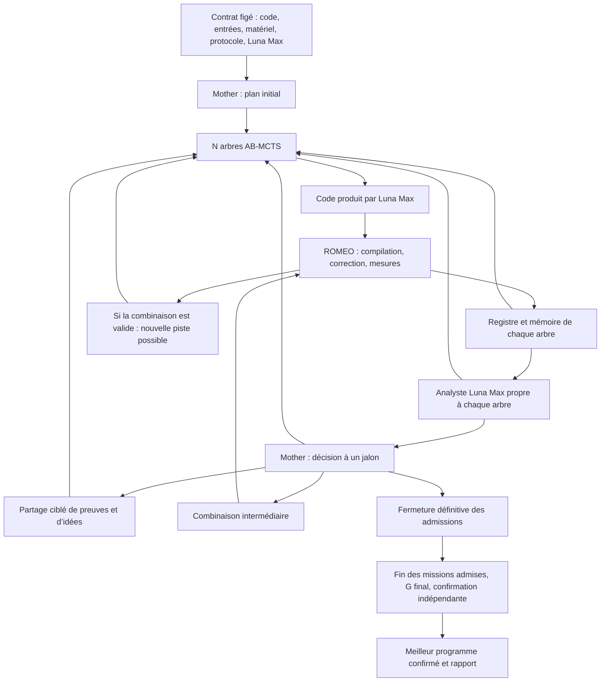

# Plan d’intégration de la nouvelle architecture Forest

Date : 24 octobre 2026. Statut : proposition de mise en œuvre, sans modification du moteur ni nouvelle exécution ROMEO.

## 1. Objectif et contrainte fixée

Faire progresser Forest grâce à son organisation : exploiter les expériences de chaque arbre, orienter la recherche en cours de campagne et tester des combinaisons intermédiaires. Mesurer séparément la contribution de chaque ajout.

**Décision de l’utilisateur : tous les rôles utilisent `gpt-6-luna`, avec `reasoning_effort = max`.** Cela inclut Mother, la génération, les réparations, les analystes, les décisions de partage et l’intégration. Aucun recours à Jev de TypeSafe, Sol, Astra ou un autre modèle dans cette série d’expériences. « Analyste » désigne désormais un rôle de Luna Max.

Le modèle et l’effort sont vérifiés dans le plan, chaque requête et les reçus disponibles. Une identité différente produit une erreur explicite ; aucune substitution silencieuse. Conserver aussi la version résolue si le fournisseur l’expose, les dates et la version du transport. Un identifiant de modèle constant ne prouve pas à lui seul l’immuabilité des poids hébergés.

Fixer le modèle permet de mieux isoler les effets de l’architecture. Cela ne suffit pas à attribuer un échec à l’architecture : manque d’informations, limite du modèle, bruit de mesure et défaillance d’infrastructure doivent rester distingués.

## 2. État actuel vérifié

Dépôt inspecté en lecture seule : `C:/Users/nicol/Documents/Codex/2026-10-20/new-chat/outputs/hpc-forest-r1`, branche `main`, HEAD `bb15d88`. Le dépôt était propre lors de l’inspection. Aucun index `.codegraph/` n’est présent.

| Élément | Fonctionnement actuel | Évolution nécessaire |
| --- | --- | --- |
| Plan initial | Mother choisit N sujets ; le temps disponible ne figure pas dans sa planification. | Lui fournir le budget et les ressources dans la nouvelle politique, puis permettre des décisions en cours de recherche. |
| Recherche | Vrai TreeQuest AB-MCTS-A ; une mission de recherche non terminée par arbre ; générations indépendantes. | Ajouter des points d’analyse sans modifier les récompenses ni réinitialiser les arbres existants. |
| Mémoire | Mémoire propre à chaque arbre, preuves paginées, variantes lentes et échecs déjà archivés. | Ajouter les bilans des analystes et des échanges explicitement autorisés. |
| Mother | Conversation persistante ; critique possible du plan initial, puis attente pendant la recherche. | Introduire des tours de pilotage appuyés sur des instantanés cohérents. |
| Intégration | `memory-guided-v1` peut déjà consulter des idées et mesurer plusieurs combinaisons après fermeture de la recherche. | Permettre une intégration intermédiaire et l’ouverture d’une recherche issue de son résultat. |
| Fin | La fermeture est définitive ; G final et confirmation indépendante restent obligatoires. | Conserver cette fin définitive, distincte des jalons intermédiaires. |

Points d’ancrage vérifiés : `Controller._complete_generation()` enregistre le résultat puis synchronise la mémoire ; `forest_scheduler.run_research()` gère les admissions ; `completion.finalize()` inscrit la fermeture définitive ; `codex_conversation.validate_turn()` limite les phases de Mother ; `MemoryReader` réserve actuellement la vue globale au rôle G.

**Le travail principal porte donc sur l’ordonnancement, les nouveaux contrats de décision et leur traçabilité.** La mémoire et AB-MCTS constituent déjà un socle réutilisable.

## 3. Architecture cible proposée

Chaque boîte impliquant un modèle utilise Luna Max. Les décisions du contrôleur, les validations de contrat et les mesures restent du logiciel déterministe. Le contrôleur et les évaluations tournent sur ROMEO ; l’inférence reste hébergée et passe par le relais existant. Le rapport doit continuer à distinguer ces lieux d’exécution.

### Analyste local

Un analyste logique par arbre, avec un historique durable séparé. Pour la première version, reconstruire chaque appel depuis un instantané explicite de la mémoire : identités, parent exact, derniers résultats, meilleur candidat, alternatives pertinentes et analyses précédentes utiles. Les preuves complètes restent consultables par pages. La mémoire applicative évite de dépendre d’un historique de conversation invisible.

L’analyste peut lire les preuves de son arbre et les références techniques autorisées. Il ne modifie pas le code, les scores, les tests ou l’état TreeQuest. Une demande de profilage supplémentaire devient une expérience soumise au contrôleur et comptabilisée.

Son bilan contient :

- l’arbre, la version du plan et l’instantané examinés ;
- les identifiants des essais et des sources consultés ;
- les observations mesurées, distinctes des interprétations ;
- une hypothèse et les éléments qui la soutiennent ou la contredisent ;
- une expérience précise et son critère de réussite ou d’arrêt ;
- les informations manquantes et les idées éventuellement partageables.

Les identifiants, périmètres et versions sont contrôlés automatiquement. Une explication plausible n’acquiert pas le statut de preuve par validation de son format.

Profil initial proposé : examen après trois nouveaux essais terminés dans un arbre, ou à la suite d’un résultat surprenant défini par une règle explicite. Ces seuils seront enregistrés dans la configuration ; ils sont des points de départ expérimentaux. Chaque déclenchement consomme de nouvelles preuves et possède une clé unique : pas de boucle d’analyses sur un état inchangé.

### Mother pendant la recherche

Mother consulte les bilans, le catalogue de la forêt et les preuves nécessaires. Elle reçoit le budget restant, le coût observé des phases, les travaux en cours et la réserve de finalisation.

Actions proposées : poursuivre, suspendre un arbre après son essai en cours, réactiver un arbre suspendu, proposer une nouvelle piste, autoriser un partage, demander une combinaison intermédiaire ou fermer la recherche.

Le contrôleur valide chaque action et son admission. Une nouvelle orientation substantielle ou une nouvelle base crée un nouvel identifiant d’arbre. Les objectifs, parents et résultats historiques ne sont pas réécrits. Un conseil local compatible avec l’objectif peut enrichir le contexte de la prochaine génération.

Les décisions sont appliquées aux prochaines admissions. Un résultat arrivé pendant la réflexion de Mother est conservé ; une décision devenue incompatible avec la version courante est signalée comme périmée et n’est pas appliquée aveuglément.

### Combinaisons et pistes prometteuses

Les combinaisons intermédiaires ont leurs propres identifiants, par exemple `Gm1`, et un type de mission distinct de la finalisation. Leur génération, leur validation et leur mesure consomment le budget de recherche. Leur résultat ne ferme pas l’epoch.

Une combinaison correcte, ou une variante correcte plus lente mais porteuse d’une hypothèse précise, peut servir de base à un nouvel arbre autorisé par Mother. Ce nouvel arbre possède un état AB-MCTS neuf ; sa provenance renvoie à la base exacte. Aucun score n’est transféré aux arbres sources ni inventé comme essai du nouvel arbre. Les nouveaux candidats sont mesurés selon la référence canonique de la campagne.

La priorité d’une idée et la vitesse du programme restent deux données différentes. Le meilleur programme mesuré est conservé comme référence disponible. Une branche exploratoire peut rester plus lente, mais sa poursuite nécessite de nouvelles preuves et une admission compatible avec le budget.

L’intégration finale privilégiera des changements ciblés depuis le meilleur programme correct mesuré, conformément à la note `A_FAIRE.md`. Les alternatives restent archivées et utilisables pour des expériences distinctes ; une modification dégradante ne remplace pas automatiquement le meilleur programme conservé.

## 4. Ordre d’intégration

Chaque lot ajoute un comportement activable séparément. Les campagnes anciennes conservent leurs contrats. La nouvelle politique reçoit un identifiant versionné, proposé ici : `adaptive-forest-v1` ; ce nom n’existe pas encore dans le moteur.

| Lot | Travail | Critère de passage |
| --- | --- | --- |
| 0 — Référence et contrat | Figer Luna Max partout, la configuration, le protocole et les reçus ; garder une référence du moteur actuel avec mémoire. Définir les nouveaux types de décisions et leurs permissions. | Toute requête de modèle est attribuable ; aucune identité différente n’est acceptée. Le mode historique conserve son comportement. |
| 1 — Analystes observateurs | Produire des bilans depuis des instantanés, sans les utiliser pour la sélection ou la génération. Ajouter leur comptabilité et les erreurs explicites. | Les bilans citent des preuves accessibles au moment de l’appel ; aucune écriture des états de recherche ; aucun appel rejoué après une interruption incertaine. |
| 2 — Conseils locaux | Injecter les hypothèses pertinentes dans les futures générations du même arbre. AB-MCTS continue à choisir les parents. | Le rapport relie conseil, génération et résultat ; les essais lents restent visibles ; une analyse indisponible laisse fonctionner la politique existante, avec un événement explicite. |
| 3 — Pilotage de Mother | Ajouter les jalons, les versions du plan, le budget fourni à Mother, la suspension/reprise et les nouvelles pistes. | Une action ne modifie pas un essai engagé ; aucun arbre n’est oublié ; état et décisions reprennent sans doublons. |
| 4 — Partage contrôlé | Exporter une idée et ses preuves vers un arbre désigné, avec décision et provenance. | Les périmètres entre campagnes restent fermés ; tous les imports sont visibles ; un partage ne modifie pas directement le code destinataire. |
| 5 — Intégration intermédiaire | Créer et mesurer `Gm`, puis permettre un arbre dérivé. Réutiliser les primitives de sélection, de code et d’évaluation. | Une boucle recherche → combinaison → recherche fonctionne ; le résultat Gm n’est jamais recopié aux sources ; la fermeture finale reste irréversible. |
| 6 — Validation comparative | Comparer les variantes successives sur ROMEO avec Luna Max, puis élargir au jeu complet. | Rapport par programme, répétition et rôle, avec coût total, dispersion, speedup confirmé et limites d’interprétation. |

Le premier lot d’implémentation réunit 0 et 1 : infrastructure des analystes et observation. L’activation de leurs conseils constitue un lot suivant, afin de vérifier la qualité des preuves avant de modifier la recherche.

## 5. Changements techniques à prévoir

Les chemins ci-dessous sont relatifs au dépôt inspecté. Les nouveaux modules sont des noms de travail.

| Zone | Fichiers existants concernés | Ajouts ou adaptation |
| --- | --- | --- |
| Contrats et identité | `config.py`, `forest.py`, `codex_mailbox.py`, `codex_worker.py`, `tools/native_smoke.py` | Politique versionnée ; Luna Max vérifié pour les nouvelles missions ; permissions et phases explicites. |
| Analyse | `memory_store.py`, `memory_context.py`, `memory_retrieval.py`, `source_request.py`, `model_skills.py` | Nouveaux `analysis_contract.py` et `tree_analysis.py` ; schéma de bilan ; instantanés et lectures autorisées ; instructions adaptées au rôle. |
| Ordonnancement | `forest_scheduler.py`, `controller.py`, `request_pool.py` | Admissions des analystes et de Mother ; résultats asynchrones ; application des décisions par le contrôleur seul. |
| Pilotage | `mother.py`, `mother_review.py`, `codex_conversation.py` | Nouveau `forest_decisions.py` ; jalons et révisions du plan. La critique de préparation existante ne devient pas implicitement un pilotage en cours de recherche. |
| Provenance | `registry.py`, `core.py`, `search.py`, `observations.py` | Bilans, décisions, imports, base par arbre, identifiants stables, versions et liens distincts entre délégation, recherche et intégration. |
| Intégration | `integration_policy.py`, `completion.py`, `node_harness.py` | Séparer les primitives communes de l’état « fermeture finale » ; ajouter le type intermédiaire et sa comptabilité. |
| Budget et rapports | `adaptive_budget.py`, `independent_budget.py`, `reporting.py`, `submission.py` | Prévoir le coût des nouveaux rôles ; détailler leur contribution et leur consommation ; étendre le manifeste final. |

Deux changements demandent une vigilance particulière :

1. Le lecteur mémoire ne doit pas assimiler « autorisé à lire toute la forêt » à « rôle G ». Définir une portée explicite, vérifiée par le contrôleur, pour les analystes, Mother et les imports.
2. Une combinaison intermédiaire ne doit pas appeler la transition terminale de `completion.finalize()` ni activer le verrou définitif utilisé aujourd’hui pour empêcher les reprises de recherche.

## 6. Ordonnancement, budget et reprise

Le contrôleur conserve la propriété exclusive de SQLite et des états TreeQuest. Les modèles renvoient des propositions ; le contrôleur applique les mutations validées. Une seule mission de recherche reste non terminée par arbre.

L’analyse lit un instantané durable et ne bloque pas tous les arbres. Ses conseils prennent effet à une admission ultérieure. Les tours de Mother restent séquentiels dans sa conversation persistante ; un reçu manquant ne provoque pas la création silencieuse d’une nouvelle Mother.

N reste variable. La concurrence des nouveaux rôles doit être explicite et comptabilisée : l’arrivée d’analystes ne doit pas doubler silencieusement le nombre d’appels simultanés. Le profil expérimental précise les capacités du relais et la politique de priorité. L’ouverture d’un nouvel arbre dépend de l’admission de son premier travail et de la réserve restante.

Pour toute admission, la prévision inclut les travaux en cours, l’analyse ou le pilotage demandés, les évaluations en attente et la finalisation. Elle respecte le recouvrement des appels modèle et la sérialisation des mesures, sans additionner deux fois ces durées.

Les appels admis vont à leur terme selon `finish-started`. Aucun plafond global de tokens ni arrêt forcé des modèles n’est introduit par ce plan. Les tokens sont observés ; les lectures et actions structurées conservent des limites explicites. Le coût des analystes appartient au budget total et ne s’ajoute pas gratuitement à la durée de recherche. Les dépassements effectifs sont rapportés.

Chaque décision et chaque appel possèdent un identifiant, un instantané source, une empreinte de requête et un statut. Une application est transactionnelle et unique. Après une interruption, distinguer « non invoqué », « invoqué, réponse inconnue », « réponse durable » et « décision appliquée ». Ne pas répéter un appel facturé dont l’issue reste incertaine.

Une panne d’analyste produit un avis indisponible ; elle ne rend pas un programme incorrect. Une erreur du contrat de modèle reste explicite. Les statuts actuels sont conservés : panne d’infrastructure sans score, programme incorrect avec score nul.

## 7. Mémoire, mesures et indépendance

- Une nouvelle campagne par programme, variante d’architecture et répétition : nouveau registre, nouvelles conversations et nouveaux états de recherche.
- La mémoire reste disponible entre essais d’un même programme. Elle ne traverse pas les campagnes ; les références techniques communes sont identifiées et figées.
- Chaque analyste ne voit que son arbre, la référence et les imports autorisés. Mother peut consulter l’ensemble de la campagne aux jalons.
- Les tests, tolérances, entrées et objectifs officiels sont protégés. Aucun avis ne remplace compilation, validation ou chronométrage.
- Les mesures officielles et les expériences de développement partagent le verrou de cible. Toute mesure d’un Gm est réalisée comme celle d’un nouveau programme.
- Distinguer le nettoyage de la mémoire applicative du protocole matériel : processus, échauffement, caches et réinitialisation des buffers sont documentés et identiques entre variantes. Ne pas prétendre remettre tout le matériel à zéro entre appels.
- La confirmation finale utilise des mesures indépendantes du classement de recherche. G final garde sa confirmation obligatoire et le meilleur programme confirmé est livré.

## 8. Tests d’acceptation

Les tests ci-dessous sont prévus pour l’implémentation ; ils n’ont pas été exécutés à l’occasion de ce plan.

1. **Contrat** : refus d’un autre modèle ou effort ; validation de chaque nouvelle phase et des permissions ; compatibilité des profils historiques.
2. **Isolation** : références étrangères refusées ; limites de lecture respectées ; absence de faits futurs dans un instantané ; un import autorisé conserve sa provenance.
3. **Recherche** : AB-MCTS réel conservé ; aucun score modifié par un analyste ; hypothèses distinctes des résultats ; sélection locale inchangée en mode observateur.
4. **Concurrence** : essais et bilans terminant dans le désordre, décisions périmées, ajout/suspension d’un arbre occupé, absence d’écriture SQLite depuis les workers.
5. **Reprise** : interruption avant/après invocation et avant/après application ; aucune double admission, double facturation enregistrée ou application multiple.
6. **Budget** : tous les rôles comptés ; une analyse peut être refusée faute de marge ; aucune consommation de la réserve obligatoire ; les travaux admis finissent.
7. **Boucle intermédiaire** : Gm valide, lent, incorrect ou indisponible ; branche dérivée traçable ; absence de copie de score ; retour aux arbres permis avant la clôture et interdit après.
8. **Confirmation** : meilleur candidat, référence et G final évalués conformément au protocole ; aucun résultat annoncé complet sans les reçus requis.

Étendre notamment les familles `test_independent_forest`, `test_mother_conversation`, `test_memory_integration`, `test_memory_budget`, `test_accounting_recovery` et `test_confirmation_deadline`. Ajouter des tests ciblés des nouveaux contrats, puis exécuter les vérifications requises du dépôt : `python -m pytest` et `python -m ruff check src tests`.

## 9. Protocole pour identifier les véritables apports

### Variantes comparées

| Variante | Fonction ajoutée par rapport à la précédente |
| --- | --- |
| V0 | Forest actuel avec mémoire, Luna Max, protocole figé. |
| V1 | Conseils de l’analyste local. |
| V2 | Jalons de Mother et gestion des pistes en cours de recherche. |
| V3 | Partage explicite entre arbres. |
| V4 | Combinaisons intermédiaires et branches issues de leurs résultats. |

Le mode observateur du lot 1 sert d’abord à valider la mécanique et les bilans. Un rejeu d’historique masque les résultats futurs et reste une analyse rétrospective ; il ne démontre pas un gain de recherche. Son coût est rapporté séparément.

Pour une ablation contrôlée, utiliser un plan initial commun produit par Luna Max, avec N et sujets identiques. Identifier cette préparation comme condition expérimentale et comptabiliser son coût de façon explicite. Une seconde série de bout en bout laisse Mother choisir son plan dans chaque campagne et mesure aussi cet effet.

Garder les mêmes entrées, contraintes, budgets cibles, matériel ROMEO, compilateurs, dépendances, protocole et réglages de parallélisme pour les comparaisons concernées. Alterner l’ordre des variantes pour limiter les dérives de charge. Des graines identiques ne garantissent pas des réponses identiques du service modèle ; prévoir des répétitions indépendantes.

### Cas de départ

Commencer par cinq programmes déjà présents dans les rapports :

- `reduction` : régression observée et hypothèse sur le nombre de lancements à vérifier ;
- `deferred` : stagnation et régression légère ;
- `gemm_cpu` : amélioration importante à préserver ;
- `softmax` : gain récent faible ;
- `blackscholes` : forte variabilité à 40 cœurs, à séparer d’une faiblesse de recherche.

Ces cas servent au développement du protocole. Les neuf autres programmes de la campagne de 14 forment un premier ensemble de validation distinct. Ne pas compter les 35 lignes documentaires comme 35 programmes indépendants. Les résultats publiés restent un repère documentaire ; le jugement architectural repose sur les remesures communes sur ROMEO.

Proposition initiale : au moins trois recherches indépendantes par configuration sur le petit jeu, puis davantage si la dispersion empêche de conclure. La validation finale et ses critères sont figés avant de consulter les résultats du jeu réservé. Aucune exécution ou allocation HPC n’est déclenchée par ce document.

### Indicateurs et attribution

Mesure principale : speedup du meilleur programme confirmé par rapport à la même référence remesurée. Comparer aussi directement les temps confirmés des gagnants des variantes. Rapporter les résultats par programme et leur dispersion entre campagnes.

En complément : temps jusqu’au premier gain, nombre d’essais corrects, essais sans information nouvelle, profondeur et diversité des arbres, coût et durée de chaque rôle, attentes de mesure, temps total et dépassement de cible. Conserver le lien bilan → décision → essai → résultat. Une attribution tracée est une provenance ; la causalité se juge avec les variantes contrôlées.

Les analyses consomment une part du même budget total. Rapporter séparément le temps de file SLURM, le temps actif de la campagne, l’inférence hébergée et les ressources CPU/GPU. Présenter aussi le coût observé des tokens ; un nombre d’appels identique ne signifie pas un coût identique.

Ne conserver un ajout comme configuration par défaut que si ses gains confirmés, son coût et ses régressions justifient son emploi sur plusieurs cas. Aucun pourcentage de gain universel n’est présupposé.

## 10. Livrables attendus après implémentation

- Nouvelle politique activable, profils historiques conservés et identité Luna Max vérifiée partout.
- Journal consultable des bilans, révisions du plan, imports, combinaisons et branches dérivées.
- Rapport expliquant ce que chaque arbre a essayé, ce que son analyste a proposé et ce que les mesures ont confirmé ou contredit.
- Comparaison V0–V4 sur ROMEO, avec coûts complets et limites d’interprétation.
- Schéma mis à jour une fois les contrats stabilisés, distinguant ce qui est effectivement implémenté des fonctions encore proposées.

### Sources locales de ce plan

Inspection de `AGENTS.md`, `docs/FORET-MOTHER.md`, `docs/MEMOIRE.md`, `docs/FIN-DE-RECHERCHE.md`, `A_FAIRE.md` et des modules cités, au commit `bb15d88`. Les choix d’échantillonnage s’appuient sur `outputs/comparaison-reprises/RAPPORT.md` de cette conversation. Les nouveaux comportements décrits ici sont des propositions, pas des capacités déjà présentes.
