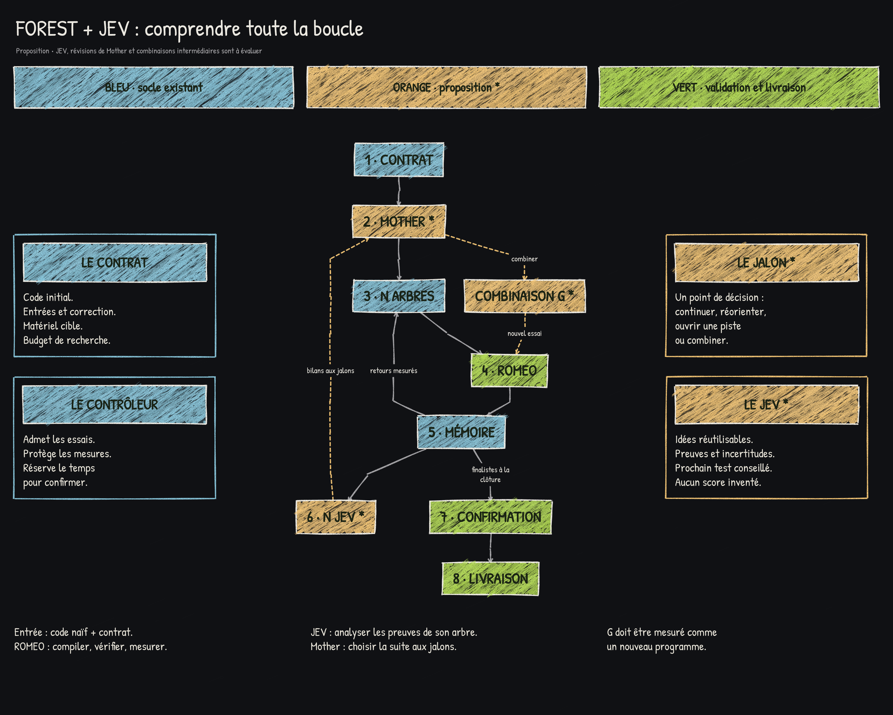
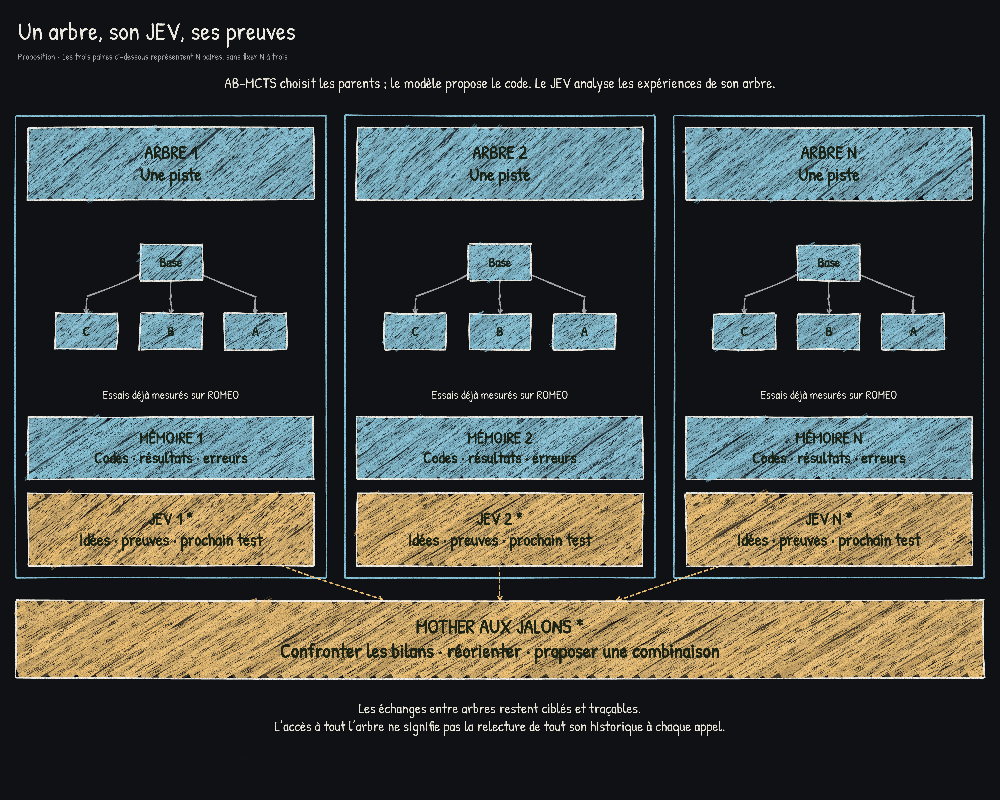
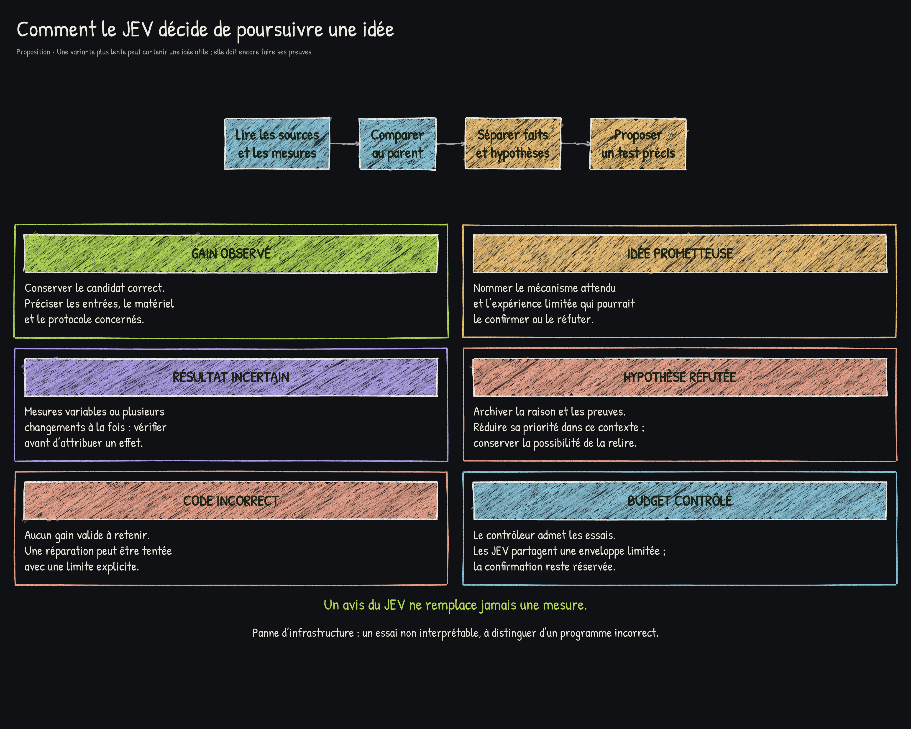
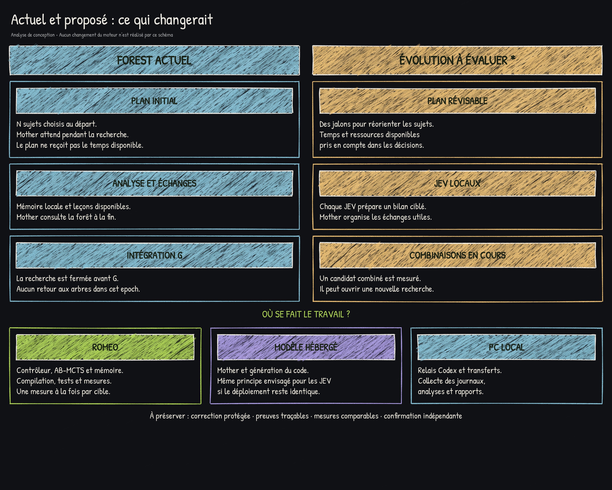

# Schémas Forest et JEV

Ces schémas sont les propositions de conception discutées avant l'intégration.
La boucle complète et les retours vers Mother ne sont pas tous implémentés.
Le premier lot utilise GPT-6 Luna avec effort Max et des analystes en observation
après confirmation ; voir [son mode d'emploi](../validation-lot1-luna-max/ANALYSTES-OBSERVATION.md).

## Vue d'ensemble

[Version SVG](01-vue-ensemble.svg)

## Arbres et analystes

[Version SVG](02-arbres-et-jev.svg)

## Décisions proposées

[Version SVG](03-decisions-du-jev.svg)

## Existant et proposition

[Version SVG](04-actuel-et-propose.svg)

Les PNG, SVG et fichiers JSON d'origine sont conservés sans modification. Les
conteneurs PDF et HTML autonome restent locaux ; ils reprennent ces visuels.
