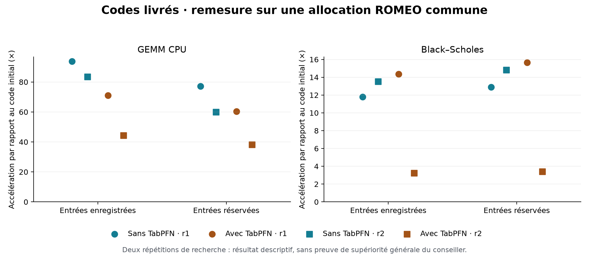
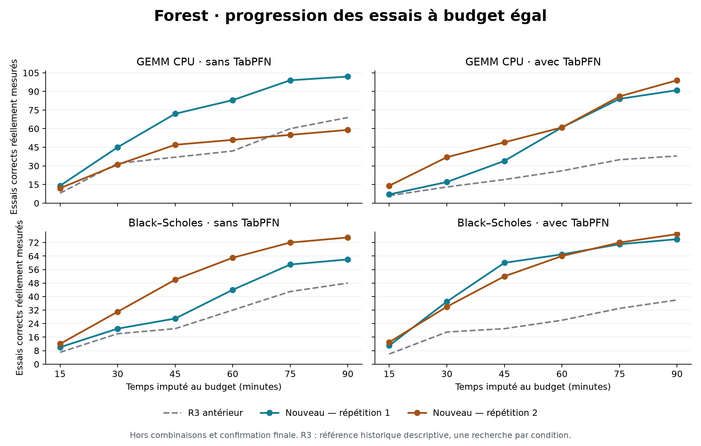

# Forest : davantage d'essais mesurés et de pistes — résultats ROMEO

Étude terminée le 28 octobre 2026 (heure de Paris). Les huit recherches et la remesure commune sont achevées. **Un seul Forest, Luna Max pour tous les rôles : 639 essais de recherche corrects sur 642, huit codes livrés, aucun échec d'infrastructure.**

Le nombre moyen d'essais corrects par recherche passe de 48,25 dans la référence R3 à 79,875 dans ce lot, soit **+65,5 %**. Cette progression concerne l'exploration ; elle ne garantit pas un code final plus rapide. Le conseiller TabPFN n'apporte **aucun bénéfice de sélection démontré** : 13 appels effectifs, une validation réussie, aucun choix de parent modifié. La régression de Black–Scholes lors de la seconde répétition avec conseiller est conservée dans les résultats.

## Corrections et périmètre

Les corrections générales ont été effectuées avant de figer le moteur et de lancer les recherches :

- La revue d'un progrès déjà analysé ne bloque plus chaque descendant moins rapide. Un nouveau progrès demande une nouvelle revue, et la clôture conserve ses exigences d'analyse.
- Mother reçoit normalement deux bilans nouveaux ensemble, ou un bilan accompagné de nouveaux essais. Les compteurs sans preuve nouvelle ne provoquent plus un appel ; les situations d'attente et de clôture restent traitées.
- Les générateurs peuvent lire des extraits bornés de codes réellement mesurés, y compris des variantes correctes plus lentes, avec empreintes et provenance. La portée reste l'arbre courant et ses imports autorisés.
- Les demandes distinguent une nouvelle piste depuis la base d'un perfectionnement du parent choisi, et demandent un mécanisme et un test vérifiables.

La politique de recherche existante reste inchangée. TabPFN est un conseiller optionnel de ce même Forest. L'archive est activée dans **les deux conditions** de cette étude. Aucun algorithme propre à GEMM ou Black–Scholes n'a été fourni aux générateurs pendant les recherches, et aucun candidat livré n'a été retouché manuellement. Les inspections de sources décrites plus bas ont lieu après les recherches.

Le détail des changements et des vérifications figure dans la [validation du lot](../../docs/VALIDATION-EXPLORATION-20261027.md).

## Protocole effectivement exécuté

| Élément | Conditions communes |
|---|---|
| Moteur | Un Forest, politique AB-MCTS-A existante, distribution gaussienne inchangée |
| Modèle générateurs, analystes, Mother et intégration | `gpt-6-luna`, effort `max`, aucun mélange |
| Comparaison | TabPFN désactivé (`off`) / activé (`corrected` dans les fichiers) |
| Répétitions | Deux par problème et condition ; graines 307 et 409 ; huit recherches |
| Plan initial | Même plan figé de Mother par problème ; conversations Mother indépendantes ensuite |
| Mémoire | Bases et sessions neuves par recherche, aucun ancien candidat ou exemple conseiller importé |
| Budget par recherche | Cible de 5 400 s, plafond total de 7 200 s ; coût du plan initial imputé également, conseiller inclus |
| Exécution | ROMEO CPU, GCC 14.2, allocation de cinq CPU et 8 Go ; quatre cœurs de mesure, un worker |
| Modèle distant | OAuth utilisé depuis ROMEO, sans relais sur le PC |
| Remesure finale | Les huit codes et les références naïves, séquentiellement sur `romeo-c023` |

Les budgets configurés sont égaux ; le temps réellement consommé et le nombre de tokens ne le sont pas. Le temps imputé final varie de **4 999,4 à 5 323,9 s**, plan initial compris. Les réserves de fin limitent l'admission de nouveaux essais avant le plafond total. Les campagnes ont été exécutées en deux vagues de quatre allocations ; les nœuds sont partagés, sans réservation exclusive.

Les recherches utilisent principalement `romeo-c023`, avec Black–Scholes sans conseiller en répétition 1 et avec conseiller en répétition 2 sur `romeo-c024`. La remesure commune réduit cette différence pour les codes finaux, sans effacer le bruit ayant pu influencer les décisions pendant la recherche.

| Problème | Tailles enregistrées | Tailles réservées | Threads mesurés |
|---|---|---|---|
| GEMM CPU | 384, 768 | 449, 897 | 1 et 4 |
| Black–Scholes | 32 768, 262 144 | 49 153, 393 217 | 1 et 4 |

Les entrées réservées n'ont pas servi aux modèles ni à sélectionner de nouveau le code final. Les traces de remesure associent chaque temps naïf et optimisé à la même taille, au même nombre de threads, à la même graine et à la même empreinte des données. Cinq échantillons de mesure existent pour chaque combinaison code/taille/threads/distribution. Leur coefficient de variation médian est de 0,35 %, avec un maximum de 5,35 % ; ces répétitions de mesure ne sont pas des répétitions indépendantes de recherche.

La qualification SLURM **786905**, les recherches **786906 à 786913** et la remesure **786914** se sont toutes terminées avec succès. La qualification a aussi effectué un véritable appel TabPFN sur des données synthétiques, qui n'ont pas été importées dans les recherches.

Sources : [protocole préenregistré](protocol.json), [audit des paires](paired-configuration-audit.json), [entrées réservées](heldout-protocol.json), [chemins et jobs](monitoring-paths.json), [reçu de remesure](receipts/common.json).

## Résultats des huit recherches

Les speedups ci-dessous sont ceux de la **remesure commune finale**, par rapport au code naïf, sur la distribution enregistrée puis réservée. Ils correspondent aux colonnes `registered_speedup` et `reserved_speedup` de [arms.csv](results/arms.csv), et non aux confirmations individuelles de chaque campagne (`speedup_common`). Tous les codes passent les vérifications des deux distributions et sont livrés dans le plafond.

| Problème | Répétition | TabPFN | Essais corrects / évalués | Arbres | Parents sélectionnés distincts | Profondeur maximale | Speedup enregistré | Speedup réservé |
|---|---:|---|---:|---:|---:|---:|---:|---:|
| GEMM | 1 | Sans | 102 / 102 | 3 | 15 | 2 | **93,87×** | 77,14× |
| GEMM | 1 | Avec | 91 / 91 | 3 | 18 | 3 | **71,08×** | 60,44× |
| GEMM | 2 | Sans | 59 / 59 | 5 | 13 | 3 | **83,51×** | 59,95× |
| GEMM | 2 | Avec | 99 / 99 | 3 | 32 | 4 | **44,27×** | 38,28× |
| Black–Scholes | 1 | Sans | 62 / 63 | 4 | 15 | 3 | **11,80×** | 12,90× |
| Black–Scholes | 1 | Avec | 74 / 75 | 3 | 14 | 3 | **14,36×** | 15,65× |
| Black–Scholes | 2 | Sans | 75 / 75 | 3 | 21 | 3 | **13,52×** | 14,82× |
| Black–Scholes | 2 | Avec | 77 / 78 | 6 | 18 | 3 | **3,23×** | 3,42× |

Les trois échecs de correction sont des essais de recherche Black–Scholes ; aucun n'est livré. Aucun essai de recherche n'est resté sans résultat de mesure ou diagnostic. Les décomptes excluent les confirmations et les combinaisons intermédiaires, pour éviter de compter ces opérations comme de nouvelles expansions des arbres.

Le rapport géométrique des speedups « avec / sans » est de **0,634 pour GEMM** et **0,539 pour Black–Scholes** sur les entrées enregistrées. Le conseiller activé gagne une des quatre paires et perd les trois autres. Avec seulement deux répétitions par problème, ces valeurs décrivent ce lot et ne constituent pas une estimation fiable d'une supériorité ou d'un effet causal général de TabPFN.

## Davantage d'essais, diversité et comparaison à R3

| Problème et condition | Essais corrects R3 | Nouveau R1 | Nouveau R2 | Speedup enregistré R3 | Nouveau R1 | Nouveau R2 |
|---|---:|---:|---:|---:|---:|---:|
| GEMM sans conseiller | 69 | 102 | 59 | 94,60× | 93,87× | 83,51× |
| GEMM avec conseiller | 38 | 91 | 99 | 28,18× | 71,08× | 44,27× |
| Black–Scholes sans conseiller | 48 | 62 | 75 | 14,33× | 11,80× | 13,52× |
| Black–Scholes avec conseiller | 38 | 74 | 77 | 13,30× | 14,36× | 3,23× |

R3 contient quatre recherches, ce lot en contient huit : la comparaison de volume utilise donc la **moyenne par recherche**, pas les totaux. Le rendement agrégé est de **56,03 essais corrects par heure imputée**, contre **34,32** dans R3, soit +63,3 %. Le gain n'est pas systématique : GEMM sans conseiller R2 produit 59 essais, contre 69 dans R3.

Les nouveaux contextes sont effectivement utilisés : **608 des 642 essais** ont reçu des extraits de sources archivées, dont **605 essais corrects** ; 585 ont été exposés à au moins une inspiration plus lente. Les arbres explorent de 13 à 32 identités de parents par recherche. Les empreintes confirment des textes de sources distincts parmi les essais corrects de chaque arbre. Ces mesures ne démontrent pas autant d'algorithmes différents : une reformulation ou un changement local de code peut changer une empreinte.

Le moteur a réalisé 276 appels natifs d'analystes et 251 appels de Mother. Cela représente environ **0,825 appel de contrôle par essai correct**, contre 1,337 dans R3, soit environ 38 % de moins. Les durées de ces appels se chevauchent avec d'autres opérations ; leur somme n'est pas un temps mural de blocage. Les 228 analyses terminées disposent de la couverture de code et des citations attendues ; ce contrôle de provenance ne prouve pas à lui seul la qualité du raisonnement.

R3 et ce lot diffèrent par l'ensemble des corrections et par l'activation de l'archive, désactivée dans R3. R3 n'a qu'une répétition par condition et ses remesures datent d'une autre session. Cette comparaison historique décrit un progrès de débit ; elle ne permet pas d'attribuer le gain à une correction isolée. Les écarts de speedup du tableau montrent aussi que **le débit supérieur n'a pas amélioré uniformément la qualité finale**.

Sources : [comparaison détaillée](results/exploration-comparison.csv), [référence R3](../quality-luna-20261027-r3/results/analysis.json), [courbes et audits R3](baseline-r3/).

## Ce qu'a réellement fait TabPFN

| Recherche avec conseiller | Exemples | Appels effectifs | Validations réussies | Choix modifiés | Temps conseiller, contrôles inclus |
|---|---:|---:|---:|---:|---:|
| GEMM R1 | 91 | 0 | 0 | 0 | 5,61 s |
| GEMM R2 | 99 | 10 | 1 | 0 | 68,67 s |
| Black–Scholes R1 | 75 | 3 | 0 | 0 | 26,03 s |
| Black–Scholes R2 | 78 | 0 | 0 | 0 | 4,83 s |

Le conseiller conserve ses 94 caractéristiques, son contexte limité à l'arbre courant et sa validation `runtime_calibrated_v2`. Il s'agit de conditionner les prédictions sur les observations de la campagne ; les poids de TabPFN ne sont pas mis à jour (`weights_updated=false`).

Trois limites différentes sont observées :

1. **Données insuffisamment indépendantes.** 144 occasions sont rejetées avant le chargement du modèle pour manque de contexte réparti entre parents indépendants. Avoir beaucoup d'essais dans toute la forêt n'assure pas assez d'exemples et de parents distincts dans chaque arbre, de part et d'autre de la séparation chronologique de validation.
2. **Prédictions non validées.** Sur GEMM R2, neuf appels échouent au contrôle de calibration : l'erreur sur la valeur attendue de l'enfant dépasse celle du prédicteur qui conserve la valeur du parent. Sur Black–Scholes R1, les trois appels échouent au contrôle de classement des enfants, avec respectivement 1/9, 5/11 et 5/11 comparaisons correctement ordonnées.
3. **Une validation ne suffit pas à justifier une intervention.** L'unique avis validé, sur GEMM R2, classe correctement 8/9 comparaisons réservées à la validation. Mais son avantage prédit sur le choix initial est d'environ 0,97 dans l'échelle `log1p(speedup)`, inférieur à la marge empirique de 2,00. Le journal indique `decision_guard=insufficient_margin` : Forest conserve donc le choix initial. Cette marge empirique n'est pas une borne de confiance statistique.

Les quatre campagnes avec conseiller consomment au total 105,14 s dans le chemin du conseiller, contrôles compris. Aucun des 13 appels n'a entraîné de réordonnancement. **On ne peut donc pas expliquer la mauvaise solution Black–Scholes R2 par un parent choisi par TabPFN : aucun appel prédictif n'a eu lieu dans cette recherche.** Le surcoût, les métadonnées visibles, les décisions de Mother et l'aléa des générations peuvent néanmoins faire diverger les trajectoires. La condition n'étant pas masquée aux modèles, l'activation ne constitue pas un placebo parfaitement neutre.

Les garde-fous n'ont pas été abaissés pour forcer des interventions après lecture des résultats. Le conseiller reste optionnel ; un bénéfice de son classement n'est pas établi par ce lot.

Sources : [décisions du conseiller](results/adviser-decisions.csv), [contrôles avant appel](results/adviser-preflight.csv), [preuves et prédictions](results/analysis.json).

## Arrêts et rôle de Mother

Les huit recherches se terminent avec `stop_reason=final_reserve_or_deadline` et `forest_closed=false`. Aucune clôture terminale prématurée, aucun état Mother cassé et aucun analyste indisponible ne sont enregistrés. R3 terminait déjà avec ce motif ; l'absence de clôture ne suffit donc pas à expliquer le gain de débit de ce lot.

Les contrôles ont rejeté **10 demandes de fermeture** et **56 demandes de suspension**. Trois actions `close` portent le statut `applied` : elles amorcent une revue de fermeture et ne correspondent pas à une fermeture terminale. Les confondre avec l'arrêt effectif donnerait une mauvaise lecture des journaux.

Des reprises automatiques après revue sans clôture valide apparaissent dans les deux recherches Black–Scholes avec conseiller. Mother ouvre aussi deux nouveaux arbres dans GEMM sans conseiller R2, un dans Black–Scholes sans conseiller R1 et trois dans Black–Scholes avec conseiller R2. Les combinaisons intermédiaires ont bien lieu et sont évaluées comme des essais distincts ; leur nombre ne constitue pas une preuve de gain.

Des suspensions et attentes de revue subsistent, notamment quand tous les arbres sont temporairement suspendus. Les protections permettent de reprendre ou de confirmer correctement ; elles ne garantissent pas que le meilleur usage du budget soit fait à chaque décision. Le cas à six arbres mais faible speedup illustre cette limite.

Sources : [actions de Mother](results/mother-control.csv), [événements](results/mother-events.csv), fichiers `*-stop-timeline.json` et `*-control-calls.csv` dans [results/](results/).

## Pourquoi certaines solutions finales restent lentes

L'inspection suivante est une **interprétation des sources livrées**, pas une expérience isolant chaque optimisation ni un profilage du code machine.

- **GEMM R2 avec conseiller, 44,27× :** le code sépare un chemin monothread bloqué 8×8 et un chemin multithread qui met à jour des blocs de quatre lignes dans la matrice de sortie. Le micro-noyau bloqué n'est pas réutilisé de la même façon dans ce second chemin. Le code sans conseiller, à 83,51×, accumule des blocs 4×16 et déroule la dimension interne. Cette différence de réutilisation et d'accumulation est une explication plausible à vérifier par profilage. L'exploration plus profonde, avec 99 essais et 32 parents, n'a pas garanti un meilleur noyau final.
- **Black–Scholes R2 avec conseiller, 3,23× :** le code utilise des vecteurs de quatre valeurs pour une partie de l'arithmétique, mais appelle explicitement `logf`, `expf` et `sqrtf` séparément par voie. Le code sans conseiller, à 13,52×, possède des chemins AVX2 de huit voies pour les fonctions correspondantes, avec des replis scalaires. La vectorisation partielle est un goulot plausible. Les 78 essais et six arbres ne démontrent pas que Forest a exploré avec succès le même mécanisme que l'autre campagne.

Les entrées réservées confirment l'écart de Black–Scholes R2 : 3,42× avec conseiller contre 14,82× sans. La régression ne disparaît donc pas lorsqu'on change ces tailles. La campagne Black–Scholes R1 avec conseiller atteint en revanche 14,36× et 15,65×, ce qui montre une forte variabilité des solutions trouvées.

Les [huit sources livrées](delivered-codes/) sont conservées sans modification, avec leur [manifest d'empreintes](delivered-codes/manifest.json).

## Validation et pièces reproductibles

La suite locale finale donne **1 163 tests réussis, zéro échec et trois tests exclus**, complétée par neuf tests d'interface et Ruff sans erreur. Les exclusions concernent deux tests POSIX sur Windows et un environnement Sakana-M optionnel ; la politique utilisée dans cette étude est couverte. Les essais initiaux en échec et leur correction restent documentés dans la [validation du lot](../../docs/VALIDATION-EXPLORATION-20261027.md).

L'[audit final](results/final-verification.json) confirme :

- 1 300 appels natifs, tous avec Luna et l'effort Max ; huit conversations Mother indépendantes et mémoires neuves ;
- 116 fichiers du moteur figé et 186 fichiers de source/test inchangés depuis leurs manifestes de référence ;
- huit sources livrées intactes, résultats de remesure complets et audits sans erreur ;
- 24 fichiers de campagne transférés vérifiés contre les reçus et la récupération commune : huit archives, huit résultats et huit sources.

Les principales données sont disponibles dans [arms.csv](results/arms.csv), [exploration-comparison.csv](results/exploration-comparison.csv), [paired-contrasts.csv](results/paired-contrasts.csv), [configuration-timings.csv](results/configuration-timings.csv) et les [preuves des temps par configuration](results/configuration-timing-evidence.json). Les scripts de collecte, d'audit et de figures sont dans [reproduction/](reproduction/). Les reçus sont dans [receipts/](receipts/) ; les archives brutes récupérées sont conservées dans le répertoire local de travail indiqué par les audits, en dehors du dépôt.

Les limites restent deux problèmes, deux répétitions par condition, des nœuds partagés, des budgets de temps égaux mais des consommations différentes, et une comparaison historique R3 non simultanée. La correction est vérifiée sur les contrats et les entrées testés ; elle n'est pas une preuve formelle pour toutes les entrées. Le résultat établi de ce lot est un **débit d'exploration supérieur avec une exécution complète et traçable**. L'amélioration générale du code final et l'utilité décisionnelle de TabPFN restent à démontrer.
